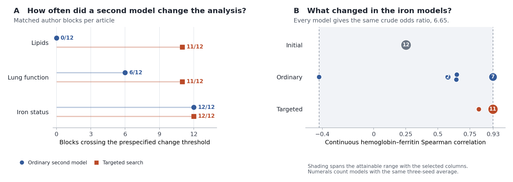

# Which conclusions survive a change in the virtual pairing?

A paper can give a researcher enough information to recover one scientific answer and leave a second answer open. Across three original biomedical articles, the agent extracted the reported quantities, wrote a program that assigned measurements to virtual people and produced an alternative under the same source checks. Changing only the assignment could materially change a screening proportion or a continuous correlation while its companion analysis stayed fixed. Asking explicitly for a different scientific answer had a large effect in the lipid case, a smaller and less certain effect for lung function, and no additional yield on the prespecified iron outcome.

## What was held constant?

Twelve initial authors per article read its full scientific text, located the required estimates and submitted their scientific model, parameter sources and Python sampler. Both follow-ups received the same article, study request, supplied marginal conventions, initial submission, GPT model, tool access and allowance. An ordinary request asked for another defensible model. The targeted request additionally asked for a different within-person assignment that would materially change the declared analysis, in either direction. An isolated service evaluated the two programs with three common random seeds. Exposing the analysis question is appropriate when the task is to test its sensitivity. Outcomes and patient records were withheld. The investigator chose the measurement grids and estimators. The agent chose and implemented the assignment of measurements to people. [Lipid registration](../article_pairing_2026-11-22/PROTOCOL.md) · [Lung registration](../article_lung_pairing_2026-11-22/PROTOCOL.md) · [Iron registration](iron/PROTOCOL.md)

## The same analysis on two admissible datasets

| Source | Companion analysis fixed by the supplied columns and constraints | Analysis sensitive to pairing | Ordinary / targeted blocks with material change | Median absolute change, ordinary / targeted | Paired exact p |
|---|---|---|---:|---:|---:|
| Mwanza lipids | Mean non-HDL cholesterol, 128.77 mg/dL | Fraction with non-HDL ≥160 mg/dL | 0/12 · 11/12 | 0.27 · 13.18 percentage points | 0.00098 |
| Polish lung function | Ratio of sex-standardized mean FEV1 to mean FVC, 76.24% | Fraction with individual FEV1/FVC <0.70 | 6/12 · 11/12 | 7.31 · 24.76 percentage points | 0.0625 |
| Xianghe iron status | Crude odds ratio of anemia comparing ferritin <15 versus ≥15 µg/L, 6.653 | Continuous hemoglobin–ferritin Spearman correlation | 12/12 · 12/12 | 0.677 · 0.677 correlation units | 1.0 |

The prespecified change margins for the pooled analysis were 4 percentage points, 5 points and 0.10 correlation units respectively. Every seed also had to move in that direction by more than 2 points, 2 points and 0.05 units respectively. Twelve assigned blocks remain in each denominator per paper. Medians describe eligible pairs. One lung initial submission omitted required decision-record fields, leaving 11 fully evaluable lung blocks. The 36 assigned blocks, 106 issued calls, 105 eligible scientific programs and 315 recalculated tables are counts for these three matched comparisons. The unit of publication-level replication is three articles. Earlier cohort transfer experiments used different questions and denominators. [Lipid results](../article_pairing_2026-11-22/RESULTS.md) · [Lung results](../article_lung_pairing_2026-11-22/RESULTS.md) · [Iron results](iron/RESULTS.md)

Lipid results supply the strongest controlled evidence for an incremental effect of the targeted instruction. In lung function, five discordant blocks favored targeted search. A post-outcome audit found that a median 15.28% of virtual records in targeted models sat between ratios 0.695 and 0.705, compared with 2.63% in ordinary models. Evidence that a screening proportion *can* move under the supplied constraints leaves its actual prevalence in a new population unresolved. The source gave a sex-specific regression and correlation, but did not report the frequency in that narrow interval. [Lung cutoff audit](../article_lung_pairing_2026-11-22/CUTOFF_AUDIT.json)

The iron article presents the complementary case. The original category counts determine the crude odds ratio. With the registered rank grids, sorting ferritin within each Hb band in the same or opposite rank order attains Spearman correlations of 0.9277 or −0.4266. This bound was calculated after the authoring experiment. All twelve initial programs produced the same assignment files at the matched seeds, with average correlation 0.2512. Seven ordinary follow-ups and eleven targeted follow-ups attained the upper endpoint, and one ordinary follow-up attained the lower endpoint. Here another ordinary model was sufficient to demonstrate the ambiguity. A positive anemia–depletion association and a negative continuous correlation can coexist under the same published checks. Biological credibility at either endpoint requires independent information on paired measurements. [Proof and numeric checks](iron/RANK_AUDIT.json)

## What the KDD manuscript can claim

A scientific modeling agent can give the researcher an executable second dataset and show exactly which answer changes when an unresolved within-person assignment changes. Reporting both answers in scientific units makes the assumption inspectable. The classical statistical fact that marginal distributions can admit many joint distributions supplies the mathematical basis. The contribution tested here is whether an agent can turn that fact into a usable, evidence-compatible counterexample for a specified biomedical analysis, how often an ordinary second model already does so, and what the resulting rows actually imply.

Lead with one real research question, two virtual datasets and the same estimator applied to both. Then distinguish the sources of agreement: the non-HDL mean follows by subtraction, the iron odds ratio follows from the four source counts, and the lung ratio follows from the chosen means. In contrast, the individual-level screening and rank analyses require pairing. Keep measured-sample agreement in a separate panel with an actual target. Earlier frozen grip predictions illustrate the difference. The average absolute grip gap was 3.81 kg compared with 3.30 kg and 3.78 kg in two primary measured samples. The added matched experiments evaluate which alternative datasets are possible. A sign reversal in a sensitivity analysis says nothing by itself about the sign among real patients. [Earlier measured grip comparison](../bilateral_grip_transfer_2026-11-21/RESULTS.md) · [Current full manuscript](../../manuscript/kdd_draft_v49_2026-11-21/README.md) · [Manuscript-ready results page](paper-results.pdf)

## Cost, reproducibility and study disposition

| Published source | Assigned initial blocks | Actual GPT API calls | Eligible programs | Independently recomputed tables | Usage-derived API cost (USD) |
|---|---:|---:|---:|---:|---:|
| Lipids | 12 | 36 | 36 | 108 | 2.6669620 |
| Lung function | 12 | 34 | 33 | 99 | 2.3535948 |
| Iron status | 12 | 36 | 36 | 108 | 2.4118712 |
| **Total** | **36** | **106** | **105** | **315** | **7.4324280** |

All issued calls returned token usage. Tariffs use those receipts, not a provider invoice or remaining account balance. Each article had a registered ceiling of USD 18. No additional calls were made for this synthesis or the exploratory checks. The registered progression rule closed this expansion when iron tied. The Australian grip article was screened and its original table was verified, with zero matched grip authoring calls. The previously completed grip study remains available as separate evidence. The next step for this version is manuscript integration and comparison with the existing measured-sample evidence. [Progression rule](DESIGN.md) · [Fourth candidate disposition](grip/ADMISSION.md) · [Iron model code and decisions](iron/PROGRAMS.json) · [Figure as vector PDF](article-comparison.pdf)
