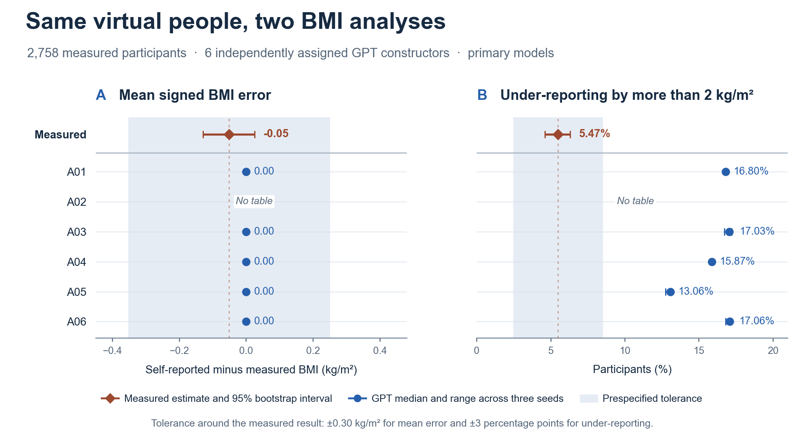

# A virtual cohort recovered mean BMI reporting error and overestimated large underreports

Starting with a question about adult BMI, GPT searched among two studies screened for public paired measurements, opened both, and chose the Malaysian community screening study. Six fresh GPT authoring sessions received the same published article projection. Five supplied an executable paired cohort; the second session hit the design output limit and supplied none. Both the programs and the scoring rules were frozen before we calculated either reference endpoint. The result met the average-error tolerance in five of six assigned slots and the large-underreport tolerance in zero. **The registered criterion of at least four of six meeting both tolerances failed.** [Protocol](PROTOCOL.md) · [Pre-reveal seal](PREREVEAL.json) · [Original article](https://doi.org/10.1371/journal.pone.0280483)

## The same two analyses on virtual and measured people

[Vector figure](FIGURE.pdf)

| Analysis | Workbook reference | Primary virtual predictions | Prespecified tolerance, all three seeds | Constructors meeting tolerance |
|---|---:|---:|---:|---:|
| Mean reported minus measured BMI, kg/m² | −0.0512 (95% bootstrap interval −0.1288 to 0.0245) | 0.000 to displayed precision for all five | 0.30 kg/m² | 5/6 |
| Proportion with reported BMI more than 2 kg/m² below measured | 151/2,758 = 5.475% (95% bootstrap interval 4.604–6.309%) | 13.06–17.06% across the five primary seed medians | 3 percentage points | 0/6 |

The source reported both BMI means as 25.2 kg/m² to one decimal place. Subtracting them provides direct support for an approximate zero. There was no disclosed empirical count for the second endpoint in the materials delivered to the agents. Across all 15 primary tables the predictions ranged from 12.74% to 17.21%. Across independent constructors the median of their primary estimates was 16.80%, about 11.33 percentage points above the measured fraction. The biological population, study, source article and underlying GPT were each held constant. Seeds and virtual records are not additional independent studies. [Source exposure review](PREBUILD_READING.md) · [Scoring output](AGGREGATES.json)

The release contains 2,781 rows. The adult filter retained 2,758 rows with paired measurements; 13 lacked age and 10 were younger than 18. BMI was calculated from each participant's recorded height and weight on both sides. No adult was tied at the strict two-unit boundary. A second implementation using independent workbook parsing and decimal arithmetic reproduced all counts and means. Rounding both BMIs to one decimal before differencing gave 5.22%. Even counting every one of the 23 excluded records as a large underreport would yield at most 174/2,781 = 6.26% across the full file. The gap from the virtual primary rates therefore cannot be explained by this age restriction alone. [Independent calculation](INDEPENDENT_MEASURED.json) · [Publisher's data](https://doi.org/10.1371/journal.pone.0280483.s001)

| Assigned author | Primary rate, median over seeds | Alternative rates, median over seeds | Trial decision |
|---|---:|---|---|
| A01 | 16.80% | 21.04%, 12.76% | Retained |
| A02 | No cohort | No cohort | Design output limit |
| A03 | 17.03% | 21.14%, 7.14% | Retained |
| A04 | 15.87% | 2.28%, 25.25% | Retained |
| A05 | 13.06% | 21.14%, 3.58% | Retained |
| A06 | 17.06% | None declared | Retained |

Two of the eight alternate specifications fell inside the three-percentage-point margin on every seed. Neither had been chosen as its author's primary. They demonstrate sensitivity to the modeling decision; selecting them after unblinding would change the scientific question. [Full program and receipt audit](AUTHOR_AUDIT.json)

One additional comparison shows why checking overall dispersion is insufficient. A06's median virtual SD of the paired difference was 2.093 kg/m². The measured SD was 2.097 kg/m². Even with nearly equal means and SDs of the difference, its median virtual underreporting rate was 17.06%, against 5.475% measured. This is a descriptive check on that author, after the registered scoring. [All seed-level statistics](AGGREGATES.json)

## Which published information went unused?

The article supplied Table 3, a joint classification of self-reported and measured BMI. All five authors documented leaving its counts out of numerical calibration. In the source table, 2,462/2,781 participants (88.53%) remained in the same BMI class. All 15 primary virtual tables produced lower agreement, from 72.22% to 76.51%. The normal/normal cell accounted for 28.16% in the source and 14.45–16.06% in the virtual cohorts. Even the marginal proportion with a normal measured BMI was understated. Thus matching marginal means and SDs left discrepancies in both the marginal shapes and the joint classification. This diagnostic was added separately from the primary grade and solely uses published counts and virtual measurements. [Independent category audit](CATEGORY_READING.md)

The continuous threshold can be crossed within a BMI class. Exact class agreement would still leave uncertainty about the positions of values within each cell. This case supports a testable design improvement: have an author elect to constrain published joint counts and explicitly vary within-cell pairing, then assess a previously untouched threshold on separately frozen data. The present experiment does not estimate the gain such a change could achieve. The reference is from the same study, its published summaries were available to all authors, and the autonomous choice was within a metadata-screened two-paper set. Generalization to new populations is a separate claim.

## Execution and cost

Twenty-one provider receipts cover five study-selection calls and sixteen constructor calls, including the truncated design. All were issued to the configured GPT endpoint; estimated cost, based on returned usage and recorded rates, was USD 1.0722525 (selection USD 0.0784795, construction USD 0.9937730). No credit balances were queried. The prespecified USD 11.75 ceiling applied to this experiment. Five constructors delivered 15 primary and 24 alternative tables, 10,000 virtual people per table. The original workbook, generated rows and provider payloads remain local. [Selection and construction rules](PROTOCOL.md) · [Recorded usage](AGGREGATES.json)
