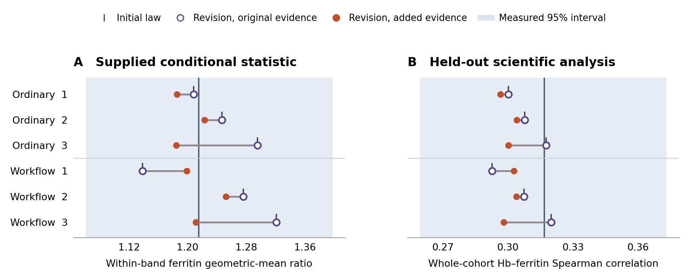

# What one additional iron-status statistic changed in held-out CHNS communities

**All six revised cohorts reproduced the two prespecified scientific associations within the study's working tolerances. The extra conditional statistic improved the overall rank estimate in one of six comparisons with an equally funded revision using the original evidence.** The largest absolute rank error before adding evidence was 0.024. At the observed reference, even a perfect update could not reduce that error by the prespecified 0.05. This gives a positive case for analysis-level utility and an informative null result for incremental accuracy. [Frozen protocol](PROTOCOL.md) · [Complete numerical results](RESULTS.json)

## What the agents saw and what was held out

We reused the 2009 China Health and Nutrition Survey. Among 2,218 linked age-eligible women with the required design fields, 2,205 had positive paired central hemoglobin and uncorrected serum ferritin. Within each of nine provinces we allocated whole communities to A or B. The 1,123 women in 110 A communities supplied the scientific evidence. The 1,082 women in 107 B communities supplied the evaluation. The halves shared no communities, households or people. The analysis describes the selected women aged 18–49 with both measurements. No national weighting or pregnancy-based selection was applied. This is a new endpoint and partition within a previously used study family. [Partition record](PARTITION.json) · [Biomarker release](https://doi.org/10.15139/S3/GQ9GPP) · [Demographic and survey companions](https://doi.org/10.15139/S3/9PQ5KV)

Both arms received the same original Zhu article, two study-format tables newly tabulated on A, the same research request and the same GPT-6.1 Sol configuration. The study-format tables distinguish the target-like CHNS evidence from the external Hebei paper. They include the threshold cross-tabulation and hemoglobin-band summaries. Neither article nor supplement supplies B's results. The ordinary Agent authored a generator directly. The workflow added the project's evidence-cohort-generation skill. The same isolated executor and source-check feedback served both arms. Three independent initial authors per arm each had two separate opportunities to revise the same sealed law. Only one sibling received a new summary from A. This was the ratio of ferritin geometric means at Hb 13–<14 versus 12–<13 g/dL, **1.215** (95% province-stratified community-bootstrap interval **1.061–1.398**). The whole-population Spearman correlation does not follow algebraically from these numbers. [Original external article](https://doi.org/10.1024/0300-9831/a000014) · [A tables](A_TABLES.json) · [Added evidence](A_SUPPLEMENT.json) · [Input audit](INPUT_AUDIT.json)

## Same scientific analysis on every cohort

The measured B Spearman correlation was **0.3168** (95% community-bootstrap interval **0.2594–0.3732**). For Hb <12 g/dL and ferritin <15 µg/L, the four counts were 114 both low, 116 only Hb low, 161 only ferritin low and 691 neither. The unweighted crude odds ratio of low Hb in the low-ferritin group was **4.218** (95% interval **2.979–6.042**). All four cells met the minimum of ten. B passed the prespecified precision check.

| Author | Rank, initial and control | Rank, added evidence | Change in absolute rank error, positive improves | Odds ratio, added evidence |
| --- | ---: | ---: | ---: | ---: |
| Ordinary 1 | 0.3003 | 0.2966 | −0.0037 | 5.115 |
| Ordinary 2 | 0.3078 | 0.3041 | −0.0037 | 4.990 |
| Ordinary 3 | 0.3176 | 0.3002 | −0.0158 | 5.122 |
| Workflow 1 | 0.2927 | 0.3028 | +0.0101 | 5.099 |
| Workflow 2 | 0.3075 | 0.3040 | −0.0035 | 5.124 |
| Workflow 3 | 0.3201 | 0.2980 | −0.0155 | 4.992 |

Ordinary and workflow arms each had three of three revised laws with absolute rank error ≤0.10. All six also met both prespecified odds-ratio tolerances. They preserved a substantial positive threshold association, overestimating the measured odds ratio by 18.3–21.5%. The crude odds ratio already available from A was 5.083. The hidden continuous relationship provides the more informative utility test. Neither arm met the rule for an incremental benefit. Median paired reductions in absolute rank error were −0.0037 for ordinary and −0.0035 for workflow, against the prespecified 0.05. Their B-sampling intervals were [−0.0037, 0.0037] and [−0.0035, 0.0090]. These intervals condition on the six constructed initial models. A workflow advantage or equivalence between authoring methods remains unresolved.

Each line follows one author. The open circle gives the revision with the original evidence and the orange dot gives its sibling with additional evidence. The small mark gives the initial model. The vertical line and shading identify the measured estimate and 95% interval in the respective population, A on the left and B on the right. Five of six updates moved closer to the supplied ratio on a log scale. One of six moved closer to the B rank correlation. The 18 control tables matched their initial counterparts byte for byte at shared seeds. All 18 added-evidence tables changed. [Vector figure](conditional_iron.pdf) · [Source estimates, execution and model hashes](SOURCE_CLOSURE.json)

## Why the local change and the overall result can differ

A **post-reveal descriptive analysis** decomposed the already scored Spearman correlation. We standardized the global midranks of each biomarker and partitioned their covariance into a between-Hb-band component and the three weighted within-band components. In B, 0.27054 of the total 0.31680 arose between the three broad Hb bands. Their within-band contributions were 0.01151, 0.03429 and 0.00046 from lowest to highest. These terms add to the correlation. They describe statistical grouping within the measured sample.

In **all six** comparisons the revision moved the middle band's contribution toward B's 0.03429. Median absolute error in that contribution fell from 0.01064 to 0.00155. The control constructions' between-band contributions were already low at 0.2444–0.2489, and remained low at 0.2444–0.2474 in their added-evidence siblings. For example, Workflow 3 began close on the global endpoint (0.3201). Its middle-band contribution was too high (0.05726) while its between-band component was too low (0.24887). The Agent replaced an assumed middle-band dependence coefficient with one calibrated to the new evidence. The local contribution improved to 0.03702 while the global estimate moved to 0.2980. In this case an initially close aggregate partly reflected offsets between its components. This analysis was proposed after disclosure. It generates a testable explanation and does not change the frozen outcome. [All models and components](RANK_COMPONENTS.json) · [Arithmetic and independent covariance identity](rank_components.py) · [Workflow 3 model decisions](laws/workflow3_evidence/decision.json)

## Implications for the manuscript

For this study population, a researcher could use any of the six final cohorts to reproduce a moderately positive continuous association and a substantially elevated crude threshold odds ratio at the declared planning tolerances. This finding concerns two group-level analyses of hemoglobin and ferritin. The design tests model authorship and revision from assigned literature plus same-population aggregate evidence. It does not test literature-only transport, free search, individual measurement recovery or incremental benefit of the skill. The two evidence contrasts should be reported separately. The prespecified global endpoint gave mixed small changes. The exploratory within-band analysis suggests what to measure prospectively if the paper claims that a revision improves the specific dependence addressed by the evidence.

Eighteen paid calls produced eighteen executable laws, each run at three shared seeds (54 private tables of 12,000 rows, 648,000 virtual rows total). The independent author count is six. No target-guided revision followed disclosure. Logs give **USD 1.7681633** using recorded tariffs, including cache writes, cache reads and all output tokens. The first implementation of the independent cost check omitted cache-write pricing. Correcting that check before the holdout opened reconciled all 18 existing receipts. The audit matched the exact submitted requests, all 22 source-table quantities and 132 initial source-feedback comparisons. Separate code verified the 54 draw hashes, scientific estimates, 2,000 bootstrap replicates per partition, paired contrasts and both arm decisions. Only original code, scientific specifications, aggregate results and figures are public. [Protocol freeze](https://github.com/ziwang11112/evidence-guided-virtual-cohorts-2026/commit/bdca7413e852d8772f043cddff82ccf98f360f0b) · [Initial-model closure](https://github.com/ziwang11112/evidence-guided-virtual-cohorts-2026/commit/d7adf17a9c07ff45f01bd2e2be6127f5037b6bae) · [Pre-reveal scientific closure](https://github.com/ziwang11112/evidence-guided-virtual-cohorts-2026/commit/5ac50fdb9d827332049bd1c564c1993e1c11ac40) · [Independent verification](VERIFICATION.json) · [Public replay](public_replay.py)
