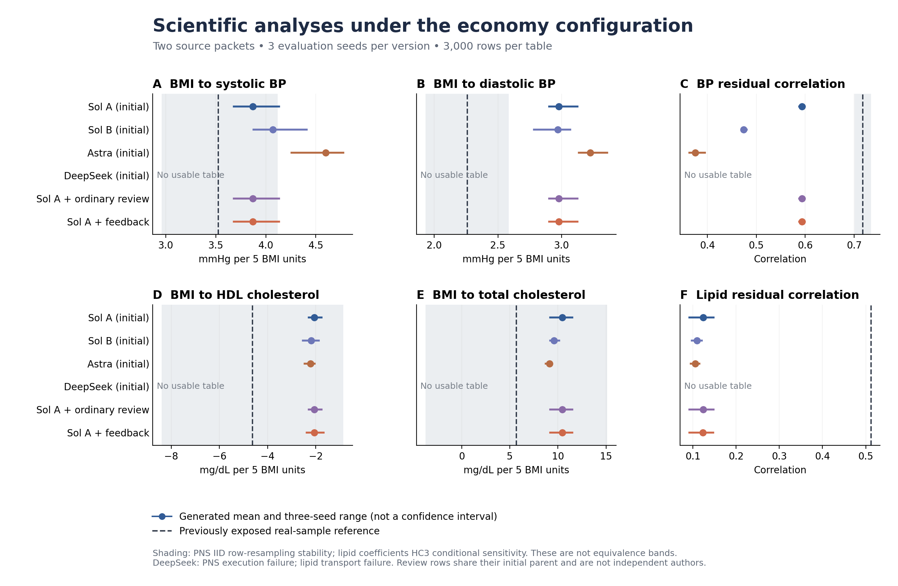
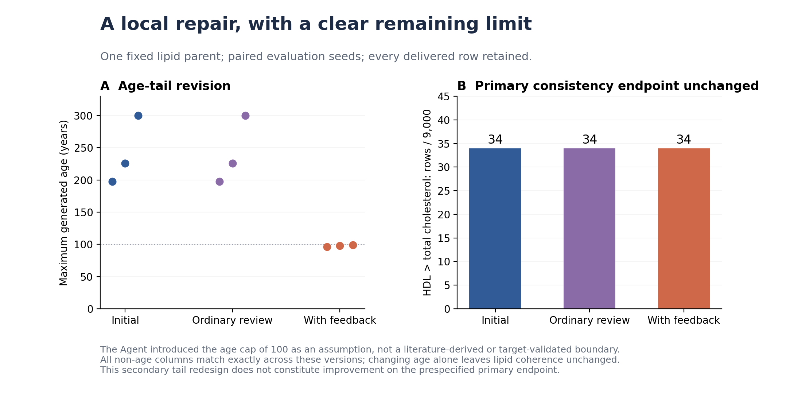

# Economy API pilot: completed results and decision

The economical configuration completed its bounded run. Sol produced all four initial generators and all four review responses; the six delivered initial GPT generators ran successfully. Generated data supported every scheduled statistical computation on successful tables, but their scientific usefulness remains analysis-specific. Feedback changed one age-tail construction without improving the prespecified component-consistency endpoint or materially changing the lipid scientific analyses.

## Design and information boundary

Two existing source packets were reused: PNS-context blood pressure and Turkana-context lipids. Each received two independent Sol constructions, one Astra construction and one DeepSeek construction. Sol_A was selected for review before outputs existed. Two new Sol requests independently reviewed the same exact initial artifact: ordinary second-look and second-look with recorded diagnostics from its own generated data. Both received the same sources and common review instruction. Neither received target results, other authors' programs, desired correlations, scientific parameters or a proposed repair.

All eight initial outcomes were closed and sealed before diagnostic sampling. Six diagnostic tables used seeds 41001, 41003 and 41007. All four review outcomes were then closed and sealed before 36 scheduled evaluation slots using fresh seeds 42001, 42003 and 42007. Each table contained 3,000 synthetic rows. Both cases are developmental evaluations against previously exposed aggregate references, not new clinical confirmation. No new patient rows were read or real-reference fits performed.

An implementation deviation was recorded before review outputs: concurrent worker dispatch did not achieve the planned branch-order counterbalancing. Both cases actually dispatched feedback before ordinary review. Contexts remained independent and all prompt bytes remained approved. No requests were replayed to conceal or correct the order.

## Delivery and cost

| Configuration | API calls | Complete artifacts | Initial laws that delivered tables | Known tariff estimate | Unknown-use reserve |
|---|---:|---:|---:|---:|---:|
| GPT-6.1 Sol | 8 (4 initial + 4 review) | 8 | 4/4 | $1.0204727 | $0 |
| GPT-6 Astra | 2 initial | 2 | 2/2 | $1.8438100 | $0 |
| DeepSeek V4 Pro | 2 initial | 1 | 0/2 | $0.07284684 | $0.21840852 |

Known usage-derived cost was **$2.93712954**. Adding the unknown reservation gives **$3.15553806** against a $10 cap. These are published-tariff calculations, not an invoice. The failed DeepSeek lipid request ended prematurely with no usage; its entire reservation remains accounted. There were no automatic retries or repair calls.

At the initial-construction stage, Sol averaged $0.1390453 per call and Astra $0.921905. These small unequal groups are useful cost observations, not a model-performance ranking.

All six diagnostic tables succeeded. Of 36 evaluation slots, 30 produced complete analyses, three failed during execution and three lacked a candidate. Thirty successful evaluation files contain **21 distinct table hashes**: retained branches reproduce their initial tables at matched seeds. These are repeated draws and workflow products, not 30 independent studies. Including diagnostics, 36 successful table outputs contain 108,000 synthetic rows; row count does not add independent evidence.

The actual DeepSeek PNS failure was `return df[task['columns']]`: `columns` contains descriptor dictionaries rather than strings, causing `TypeError: unhashable type: 'dict'` in all three scheduled executions. Its theoretically coherent law was not converted into a delivered table. This is distinct from source insufficiency or transport error. The original code and failures were preserved without repair.

## Scientific analyses on initial delivered laws

Numbers below are means over three draws from each law. They are not confidence intervals or three independent authors. For PNS, BMI coefficients are mmHg per 5 kg/m²; for lipids, mg/dL per 5 kg/m².

| Case / analysis | Sol A | Sol B | Astra | Existing real-sample reference |
|---|---:|---:|---:|---:|
| PNS: BMI–SBP | 3.871 | 4.070 | 4.600 | 3.524 |
| PNS: BMI–DBP | 2.979 | 2.970 | 3.226 | 2.260 |
| PNS: residual correlation | 0.593 | 0.474 | 0.375 | 0.717 |
| Lipids: BMI–HDL | −2.063 | −2.189 | −2.219 | −4.623 |
| Lipids: BMI–TC | 10.456 | 9.594 | 9.138 | 5.683 |
| Lipids: residual correlation | 0.124 | 0.110 | 0.105 | 0.512 |

These constructions reproduce some association directions, and Sol's PNS SBP estimate is relatively close to this sample reference. They do not reconstruct every requested relationship. Residual dependence is weaker in all six delivered initial laws across the two cases, including Astra. A more expensive model did not automatically recover the missing joint relationship here. Attribution does not establish that evidence insufficiency alone caused all differences: source transport, conditioning bridges and demographic assumptions remain involved.

Real references are uncertain. PNS intervals are conditional IID row-resampling stability intervals, not national-population design-based confidence intervals. The lipid TC coefficient has a broad HC3 conditional sensitivity interval (approximately −3.75 to 15.12), which includes zero; its point discrepancy is not proof of a precisely known population mismatch. No equivalence margin or overall quality pass threshold was invented after seeing results.

There is also no universal dispersion-shrinkage result: Sol_B PNS SBP SD is 20.287 versus reference 18.192, whereas other scales are lower. Dependence and dispersion should be reported separately.

## What the paired review actually changed

PNS ordinary review and feedback both retained the initial code and model specification exactly. Lipid ordinary review also retained them. Lipid feedback alone revised the scientific program, replacing a shifted-lognormal age distribution with a beta distribution supported on ages 18–100, while preserving assumed sex-specific age means/SDs and all BMI/lipid draws and dependence parameters. The upper endpoint of 100 was explicitly labelled an unsupported scenario assumption.

| Lipid matched-seed result | Initial | Ordinary review | Feedback review |
|---|---:|---:|---:|
| Max age, seed 42001 | 197.776 | 197.776 | 96.405 |
| Max age, seed 42003 | 225.916 | 225.916 | 97.744 |
| Max age, seed 42007 | 300.253 | 300.253 | 98.979 |
| HDL > TC across 9,000 rows | 34 | 34 | 34 |
| Mean BMI–HDL coefficient | −2.06304 | −2.06304 | −2.06585 |
| Mean BMI–TC coefficient | 10.45638 | 10.45638 | 10.46884 |
| Mean residual correlation | 0.123662 | 0.123662 | 0.123623 |

Independent checking confirms that every non-age field is exactly unchanged between parent and feedback at the same seed, including CSV field text. The revised mathematical age construction and revised projection recipe are coherent. This is a concrete example of the Agent noticing an implausible generated tail and changing its program, without host-supplied scientific parameters.

**The prespecified primary result is no improvement in component consistency.** Lipid ordering remains unresolved; blood-pressure ordering already passed. The age-tail redesign is a secondary finding, not a substitute primary success, a source-validated age distribution, or demonstrated improvement in transportability. The requested lipid analyses barely change. Merely supplying this feedback did not add missing scientific relationship evidence.

## Attribution and audit

Three reviewed artifacts are exact code/specification no-ops; their revised explanatory records are retained separately. Sol_A PNS uses exact additive-law slope claims and explicitly assumed residual dependence/scales. Sol_B derives residual covariance after subtracting modeled mean covariance. Astra adds assumed contributions for omitted source adjustment variables. Lipid authors share some source rank anchors but use different conditioning and demographic bridges. Accordingly, neither “all agents copy the same parameters” nor “all mismatches are coding defects” describes this experiment.

The independent numerical reviewer recomputed all 30 successful evaluation tables, all 72 version summaries and 36 paired endpoint-by-seed contrasts. Maximum absolute numerical difference was about 6.0 × 10⁻¹⁴, with no discrepancies. Capture audits verified requested/returned model IDs, prompt and request bytes, captured outputs, candidate lineage and usage-derived costs. No frozen historical files were edited; no extra API calls, new data search, training or HPC were used.

## Decision

Continue with Sol as the main experimental constructor and reserve Astra for selected difficult constructions or derivation checks. This is a cost-and-delivery decision, not proof that the models are equivalent. DeepSeek remains an optional inexpensive comparator; this round's failures do not justify a general quality ranking, and its next use should explicitly separate interface repair from scientific revision if such a run is later authorized.

For the paper, retain the genuine outcome: an Agent can produce analyzable virtual cohorts, with parameter provenance explaining which analyses rely on transported evidence versus unsupported joint assumptions. This run also demonstrates a diagnostic-driven local program change, alongside a null primary feedback result and unresolved dependence. Do not expand generation merely to accumulate rows, and do not make feedback superiority mandatory for the data-generation contribution.

The next useful synthesis is to merge this attribution with the previous 20-call pilot and identify analyses with consistent support versus shared unsupported dependence. Any later correction study should target that specific evidential or structural gap, with an explicit comparison and unchanged failure reporting. No further paid experiment is started by this report.

## Artifacts

- [Frozen protocol](PROTOCOL.md) and [run plan](RUN_PLAN.json)
- [All numerical results](EVALUATION.md), [machine-readable evaluation](EVALUATION.json), [cost/delivery summary](FINAL_SUMMARY.json)
- [Cross-model initial attribution](CROSS_MODEL_INITIAL_ATTRIBUTION.md), [initial paired-parent audit](SCIENTIFIC_ATTRIBUTION_REVIEW_INITIAL.md), [branch audit](SCIENTIFIC_ATTRIBUTION_REVIEW_BRANCHES.md)
- [Independent recomputation](review/INDEPENDENT_RECOMPUTATION.json), [output identity and error checks](review/SUPPLEMENTARY_OUTPUT_CHECKS.json)
- [Initial API audit](INITIAL_CALL_AUDIT.json), [review-input audit](REVIEW_INPUT_AUDIT.json), [final API audit](REVIEW_CALL_AUDIT.json)
- [Dispatch-order deviation](PROTOCOL_DEVIATION_DISPATCH_ORDER.json)

Raw API captures and generated row-level tables remain local.
