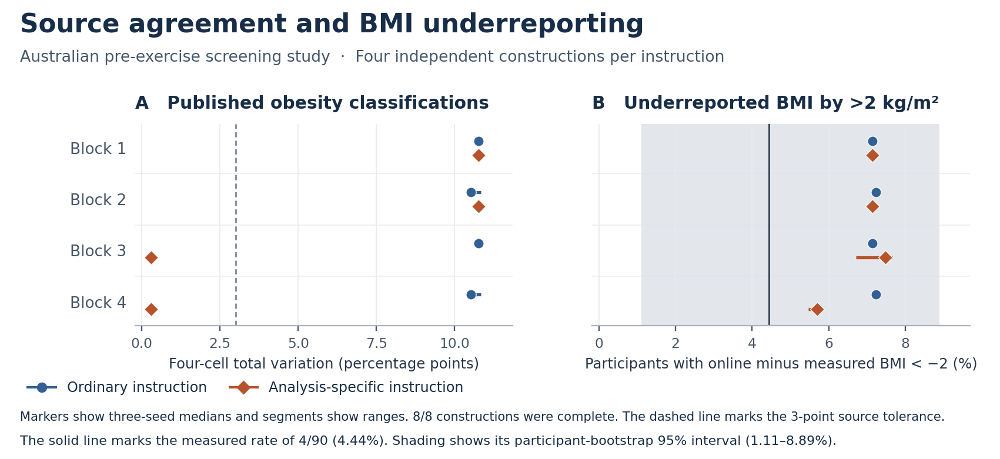

# Can an agent select and use the joint evidence needed for a scientific analysis?

In an Australian exercise-screening study, four of four agents given a general instruction to look for consequential relationships extracted the correct joint BMI evidence. Two encoded it in the generator. Among four ordinary agents none extracted the complete numeric binary relationship or encoded it. All eight programs did use the continuous paired-error information. The additional instruction made the published obesity classification easier to reproduce in two constructions. It provided little change in median absolute error for a different, unreported analysis on measured participants. [Frozen design](PROTOCOL.md) · [Norton et al., PLOS ONE](https://doi.org/10.1371/journal.pone.0199836)

## What the authors had to decide

Investigators wanted virtual individual records to estimate how often online self-reported BMI was more than 2 kg/m² below BMI from objective height and weight. Both arms received that question, the same scientific article projection and the same generator interface. The paper contains both online-versus-interview self-report agreement and online-versus-objective agreement. Its objective comparison reports 8 and 12 obesity-positive participants out of 91 and a rounded kappa of 0.776. Together these determine four counts: 8 positive on both measures, zero online-only, four objective-only and 79 negative on both. It also reports an ICC and a quantity labeled RMS for the continuous pair. A correctly oriented four-cell table does not report an individual's continuous error within a cell.

Four independent single-call constructions per arm used GPT-6.1 Sol, the same fixed evidence and output allowance. The targeted instruction asked which relationships should affect the requested analyses and how the author would recompute and incorporate them. Neither instruction supplied the table, its numbers or a preferred family. Each program generated 10,000 paired measurements at three common seeds. The authors saw no Australian participant data or evaluator answers. The source had been screened before; it had not previously supplied a generator or a scored measured endpoint in this project. The source and reference participants belong to the same study. [Materials](COMMON_PROMPT.txt) · [Gate and rubric](RUBRIC.md) · [Source and schema audit](SOURCE_AND_SCHEMA.md)

## What changed

| Prespecified measure | Ordinary | Evidence-directed |
|---|---:|---:|
| Runnable constructions / assigned | 4/4 | 4/4 |
| Correct numerical joint evidence identified | 0/4 | 4/4 |
| Binary joint evidence consequential in executed generator | 0/4 | 2/4 |
| Four-cell source proportions within 3 percentage points of total variation at all three seeds | 0/4 | 2/4 |
| Mean signed BMI difference within 0.30 kg/m² of the measured point at every seed | 4/4 | 4/4 |
| Low-reporting rate within 3 percentage points of the measured point at every seed | 4/4 | 3/4 |
| Median absolute rate error across constructors, in percentage points | 2.741 | 2.696 |

The two readers agreed on all eight artifacts for extraction, consequential use and continuous-evidence use. Both read static code, specifications and decisions in different masked orders. Neither received the measured outcome or the other reader's judgment. Coding fields or writing style could suggest a policy; the graders were AI-based. All eight interpreted the printed RMS of 1.3 as information about a paired BMI difference. The article does not fully specify its convention. A score of zero for the binary evidence in an ordinary model can coexist with substantive use of other joint evidence. [Code-level audit](COHORT_MODEL_AUDIT.json) · [Authored model code and specifications](PROGRAMS.json)

| Program | Binary constraint actively used | Source four-cell TV, mean of 3 draws (pp) | Underreporting, median of 3 draws (%) | Both scientific tolerances |
|---|---|---:|---:|---|
| Ordinary 1 | No | 10.77 | 7.14 | Within |
| Ordinary 2 | No | 10.60 | 7.23 | Within |
| Ordinary 3 | No | 10.77 | 7.14 | Within |
| Ordinary 4 | No | 10.60 | 7.23 | Within |
| Directed 1 | No | 10.77 | 7.14 | Within |
| Directed 2 | No | 10.77 | 7.14 | Within |
| Directed 3 | Yes | 0.30 | 7.48 | Outside tail margin |
| Directed 4 | Yes | 0.30 | 5.70 | Within |

After grading we compared the two programs that implemented the binary evidence. Their four cell counts were exactly equal at each shared random seed, yet their virtual continuous-tail percentages differed. For example, their first-seed predictions were 7.48% and 5.70%. They also made other choices about continuous distributions. This comparison exhibits what the four-cell constraint leaves open. It does not isolate the effect of any one within-cell modeling decision. [Every draw](MEASURED_EVALUATION.json)

## What the real participants showed

Of 90 eligible adults with complete raw measurements, 4 (4.44%, paired-participant bootstrap 95% interval 1.11–8.89%) underreported BMI by more than 2 kg/m². The mean online-minus-objective difference was −0.074 kg/m² (−0.290 to 0.140). The publication's 91-pair table included a different denominator from the adult complete-pair analysis and was retained for source replay. All eight constructors' median tail estimates were above the measured point and inside the measured sampling interval. The drop from four to three tolerance passes concerns a predefined planning margin, not a reliable ranking of the methods. The between-arm difference in median absolute tail error was 0.045 percentage points, well below the 3-point planning margin. Each of the treatment arms contains four separate constructions from one model and one paper.

The registered evaluator stopped on a fractional age between 75 and 76 before computing BMI endpoints. We recorded both readings of the paper's 18–75 age range. Completed years gave 4/90 (4.44%) and a strict numerical upper limit gave 4/89 (4.49%). All arm-level tolerance counts were unchanged. In both definitions raw heights and masses supplied the BMIs. Among 90 eligible online entries with a cached BMI, 70 agreed with recomputed BMI within 0.10 kg/m². The stored value was used for a unit check only. [Eligibility decision made before BMI scoring](ELIGIBILITY_RECONCILIATION.md) · [Strict age result](STRICT_AGE_EVALUATION.json) · [Independent recalculation](INDEPENDENT_CHECK.json)

## Interpretation for the method

This article gives direct evidence of an agent choosing the correct study comparison and implementing it without a supplied table identifier. It also shows why an audit of the executed model adds information beyond a citation in the decision record. The four-cell relationship supports fidelity for a threshold classification at BMI 30; the requested use concerns the signed difference between two continuous measurements. Increased fidelity on the former did not yield a consistent gain on the latter. This result supports reporting evidence use and scientific utility together. It gives no basis for a general advantage in data quality. Further cases should establish whether the choice of evidence changes conclusions about the specific intended analysis before scaling to more model runs.

## Reproduction

The preregistration, generated program/output hashes and completed blind coding were recorded in that order. Constructor slots, rather than simulated rows or seeds, are the comparison units. Eight billed calls cost an estimated USD 0.297293 at the recorded token rates. No outstanding reservations or unpriced calls remained. Independent calculation from all 24 virtual tables and the real workbook reproduced both age variants and the principal grades to numerical precision. The public materials include the programs, summary data, evaluator and figure code. The private author transactions and real and virtual participant tables stay local. [Preregistration](https://github.com/ziwang11112/evidence-guided-virtual-cohorts-2026/commit/e27d1fa) · [Sealed draws](https://github.com/ziwang11112/evidence-guided-virtual-cohorts-2026/commit/bcbe009) · [Blind review and age reconciliation](https://github.com/ziwang11112/evidence-guided-virtual-cohorts-2026/commit/3b88335) · [Analysis summary](ANALYSIS_SUMMARY.json) · [Figure PDF](apss-estimates.pdf)
