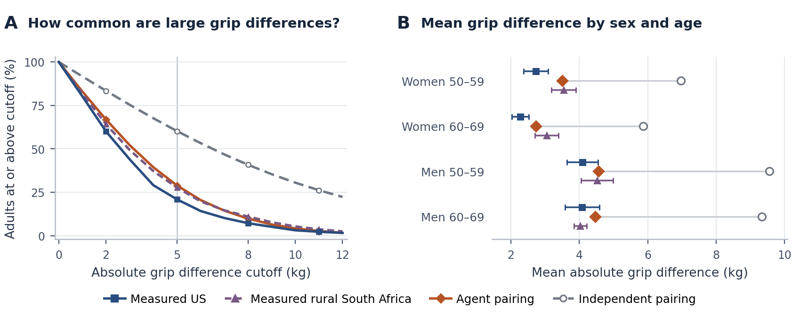

# Which uses of the same virtual handgrip data survive a change of population?

Four agent sessions read the same Australian single-hand summaries and chose the same within-group correlation of 0.80. The corresponding frozen virtual records predict a mean absolute difference between hands of 3.81 kg. The measured means are 3.30 kg in the US and 3.78 kg in rural South Africa. Randomly pairing the very same right- and left-hand values gives 7.93 kg in expectation. The earlier study sealed these predictions before opening the paired measurements. This release asks whether the pooled result holds inside the four sex-by-decade groups. The subgroup and threshold analyses are retrospective. [Earlier study and disclosure sequence](../bilateral_grip_transfer_2026-11-21/RESULTS.md) · [Analysis design](DESIGN.md)

| Use of the virtual records | US NHANES, n = 1,423 | Rural South Africa, n = 2,434 |
|---|---:|---:|
| Mean absolute difference, measured | 3.30 kg | 3.78 kg |
| Same quantity, agent pairing | 3.81 kg | 3.81 kg |
| Same quantity, independent pairing | 7.93 kg | 7.93 kg |
| Fraction with a difference of at least 5 kg, measured | 20.95% | 27.71% |
| Same fraction, agent pairing | 28.94% | 28.94% |
| Same fraction, independent pairing | 60.24% | 60.24% |

Each of the four sex-by-decade groups receives equal weight in the site-level estimates. In panel A, choose a cutoff and read vertically to compare the measured and virtual fractions. At 5 kg, the agent estimate exceeds the US and South African measured estimates by 7.99 and 1.23 percentage points. Panel B asks a different question. Each row compares the same two virtual pairings with the measured mean gap in women or men aged 50–59 or 60–69 at each site. The horizontal bars are pointwise 95% measured intervals. [All thresholds, group sizes, authors, comparators and intervals](GRIP_GROUPS.json)

Across the eight groups in the two primary samples, agent pairing reduced the absolute discrepancy by 2.50–4.99 kg compared with independent pairing. Every agent point estimate was within 0.77 kg of its measured counterpart (range 0.04–0.77 kg). Seven measured intervals lay entirely within 1 kg of the corresponding fixed agent estimate. In US women aged 50–59, the mean was 2.73 kg [2.37, 3.09], against 3.50 kg generated. The original study's 1 kg planning tolerance applies to its pooled estimate. Its use within age and sex groups here is descriptive. There are eight subgroup comparisons from two studies, and the intervals are pointwise. [Full subgroup table in the manuscript](../../manuscript/kdd_draft_v47_2026-11-21/grip_groups_table.tex)

All four groups from the Brazilian maximal-trial study (464 participants) are in the supplement. It measures the best trial per hand, whereas the primary US and South African studies use the first two trials. We also report the four authors who received an additional German hand-ratio statistic. Their standardized mean gaps were 3.37–3.41 kg, close to the 3.42 kg from a statistical rule using that same evidence. Thus the comparison with independence isolates the effect of coupling, while the matched statistical control indicates how much a common source can already determine. [Original predictions and matched statistical rule](../bilateral_grip_transfer_2026-11-21/PREDICTIONS.json)

## What the study counts

| Scientific analysis | Measured comparisons | Study settings |
|---|---:|---|
| Lifestyle contrasts | 1 | Kenyan Turkana |
| Blood pressure | 2 | Brazil and Sierra Leone |
| Iron status | 4 | US, Burkina Faso, China and Nigeria |
| Lipids | 5 | Two Ethiopian studies, a Virginia community screening and two US national survey periods |
| Bilateral handgrip | 3 | US, rural South Africa and Rio Branco |

These **15 analysis–sample comparisons** cover **14 distinct recruitment samples or survey periods, 12 study families and nine countries**. NHANES 2021–23 is used for both iron and lipids. Different analysis roles include same-study reconstruction, a community holdout and external measurements. Each row of the inventory links to its underlying result and eligible sample size. The twelve case-specific construction batches contain **59 initial authoring sessions and 228 successful seeded outputs**. The subtotal includes alternative or revised programs and outputs that can coincide. Reusing a table for a different target or endpoint adds a comparison but no new authoring session or draw. [Study and construction inventory](COVERAGE.json) · [Counting code](coverage.py)

## Verification and interpretation

The replay verified all 24 frozen pairing-file hashes and the hashes of the original local survey files. For all three populations the old standardized means, 5 kg fractions and measured intervals were recovered. A second calculation using cluster totals reproduced the twelve new measured subgroup means and their jackknife intervals. It used no new model calls, model changes, patient downloads or API fees. The public files contain aggregate results. [Replay from the original local records](grip_by_group.py) · [Public aggregate checks](verify_public.py) · [Figure code](plot_grip.py)

Patient-Zero shows cohort breadth alongside attribute-level discrepancies. KMGen varies the question from reconstructing survival to estimating adverse-event burden. We use that figure logic to show two concrete uses of the same records in natural units. The evidence that would most strengthen the paper is another paired-measurement task where a cohort built by the agent and a nonzero statistical coupling have identical inputs and their predictions are frozen before the target is opened. A pairing-sensitive estimate and a pairing-invariant estimate should be scored in the same populations. More draws of the existing programs would refine simulation error without adding an independent test of that modeling decision. [Patient-Zero, Figure 4](https://aclanthology.org/2026.emnlp-main.1149.pdf#page=8) · [KMGen, Figure 10](https://raw.githubusercontent.com/mlresearch/v340/main/assets/jiang26a/jiang26a.pdf#page=25)

A metadata screen suggests spirometry as a candidate for that comparison. The US NHANES 2011–12 codebook lists baseline FEV1 and FVC and separate quality fields. A separately recruited rural Malawian adult cohort publicly documents pre- and post-bronchodilator spirometry, with 886 participants meeting the study's baseline quality requirements. One possible analysis compares the mean of the individual FEV1/FVC ratios with the ratio of the two cohort means. With fixed marginal values only the first estimate depends on pairing. The number 886 precedes any common age or eligibility restriction. Admission still requires compatible baseline measurements, an independent source packet, eligibility and uncertainty checks, and a frozen use margin. NHANES is an existing study family. The metadata screen used no participant files or target ratio estimates and contributes zero completed comparisons to the inventory. [CDC spirometry codebook](https://wwwn.cdc.gov/Nchs/Data/Nhanes/Public/2011/DataFiles/SPX_G.htm) · [Malawi Adult Lung Health Study, original deposit](https://data.mendeley.com/datasets/whbk485wbw/1)
