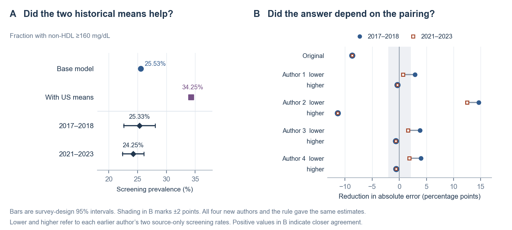

# Does a US historical mean improve a later US screening analysis?

Four new GPT authors received two published US means in addition to the original Tanzanian evidence. All four independently multiplied each marker by a constant, giving the same numerical results as the prespecified statistical rule. On the original virtual pairing the estimated percentage with non-HDL cholesterol at or above 160 mg/dL rose from **25.53% to 34.25%**. The age-standardized US survey estimates were **25.33% in 2017–2018 and 24.25% in August 2021–August 2023**. The absolute discrepancy grew by **8.72 percentage points in both periods**. In a prespecified secondary use, the original virtual cohort's mean individual TC/HDL ratio fell within the planning margin against both national surveys. [Protocol](PROTOCOL.md) · [Public prediction commitment before survey disclosure](https://github.com/ziwang11112/evidence-guided-virtual-cohorts-2026/blob/07284f6da1dc707cf8ae9b2ed4bbc2f0cd206738/biomedical_research/virtual_cohort_system/work/lipid_population_anchors_2026-11-21/PREDICTIONS.json) · [Complete comparison](RESULTS.json)

## What the agents chose

Kavishe et al. supplied a mean individual ratio, both marker means and single-marker frequencies for Mwanza. Carroll et al. reported age-standardized 2007–2010 national US mean TC of 196 mg/dL and mean HDL of 52.5 mg/dL. These were the only additional numerical constraints. The four new sessions could preserve, discount, or reshape either source marginal. They chose the same shape-preserving proportional update. It raised TC by 7.384% and lowered HDL by 2.328%, preserving every within-marker rank. The evaluator combined each grid with the same original agent pairing and with all eight earlier source-compatible alternatives. No new author had access to target records or target estimates. The earlier survey and the two evaluation periods were recruited in separate calendar periods of the same survey family. [Mwanza paper](https://doi.org/10.1371/journal.pone.0223189) · [US source article, Table 1](https://jamanetwork.com/journals/jama/fullarticle/1383233) · [Agent decisions and code](laws) · [Numerical implications published before disclosure](BEFORE_DISCLOSURE.md)

## Primary comparison

The frozen decision required the four-author median absolute screening error to improve by at least two percentage points in **both periods**. Because all four gave the same nominal predictions, their median equals the single anchored result. The ranges below vary the measured estimate over its survey-design 95% interval, holding the sealed predictions fixed. Negative gain means the new estimate was farther from the survey. All virtual methods used exactly the same target-independent estimator of the screening fraction.

| US survey | Eligible adults | Measured screening rate (95% interval) | Absolute error, base | Absolute error, with the two means | Gain across the reference interval |
|---|---:|---:|---:|---:|---:|
| 2017–2018 | 4,937 | 25.33% (22.59–28.07) | 0.19 pp | 8.92 pp | −8.72 to −3.63 pp |
| August 2021–August 2023 | 5,498 | 24.25% (22.40–26.09) | 1.28 pp | 10.00 pp | −8.72 to −7.59 pp |

Before disclosure we calculated a reference rate of 29.8875% at which the original and updated predictions would have equal absolute error. Both measured intervals fell below that rate. Despite their small point errors, the original screening estimates had uncertainty intervals crossing the ±2-point absolute-use margin. The anchored screening estimate was contradicted in both periods. Design inference used 15 strata and 30 masked PSUs per period, separate weighting schemes and direct standardization to the year-2000 adult age distribution. [2017 data documentation](https://wwwn.cdc.gov/Nchs/Data/Nhanes/Public/2017/DataFiles/TCHOL_J.htm) · [2021 phlebotomy weights](https://wwwn.cdc.gov/Nchs/Data/Nhanes/Public/2021/DataFiles/HDL_L.htm) · [CDC age-standardization guidance](https://wwwn.cdc.gov/nchs/nhanes/tutorials/samplecode.aspx)

## What a scientist can analyze on the same virtual records

Each row uses the fixed nominal pairing. The following two columns list **base → anchored** and **2017–2018 / 2021–2023** respectively. A supported use has its complete 95% interval for the fixed virtual versus measured discrepancy within the stated margin. Crossing a boundary is unresolved. An interval wholly outside is contradicted.

| Requested analysis (planning margin) | Virtual, base → anchored | National estimates by period | Base, 2017 / 2021 | Anchored, 2017 / 2021 |
|---|---:|---:|---|---|
| Mean non-HDL (±10 mg/dL) | 128.77 → 143.50 | 135.47 / 135.02 | unresolved / within | unresolved / unresolved |
| Mean individual TC/HDL (±0.30) | 3.659 → 4.023 | 3.790 / 3.732 | **within / within** | unresolved / unresolved |
| High TC (±5 pp) | 14.40% → 20.50% | 10.52% / 11.21% | unresolved / within | contradicted / contradicted |
| Low HDL (±5 pp) | 15.30% → 17.35% | 13.86% / 11.92% | within / unresolved | unresolved / unresolved |
| Non-HDL ≥160 mg/dL (±2 pp) | 25.53% → 34.25% | 25.33% / 24.25% | unresolved / unresolved | contradicted / contradicted |
| TC–HDL rank correlation (±0.10) | 0.059 → 0.059 | 0.137 / 0.206 | unresolved / contradicted | unresolved / contradicted |

The original model was calibrated to an individual ratio of 3.66 in Mwanza. Its virtual mean ratio of 3.659 met the ±0.30 criterion in both future US surveillance periods. The independently measured intervals were 3.690–3.890 and 3.661–3.802. This is evidence for transfer of one published relationship. Under the same margin, the previously evaluated Virginia community sample gave 4.530 and contradicted that use. Under any positive multipliers a and b for TC and HDL, every individual's ratio is multiplied by a/b. Here this raises the mean ratio about 9.94%, despite the added national material containing no individual ratio. Spearman correlation remains exactly invariant. The measured component means in the two national periods were TC 188.94 and 188.39, and HDL 53.47 and 53.36 mg/dL. Both target TC means lay between the two generators' TC means. [Virginia comparison](../prospective_lipid_use_2026-11-21/RESULTS.md) · [All measured estimates and uncertainty](RESULTS.json)

## How the pairing changes the effect of the same evidence

In each of the earlier authors' two models we changed only the two marginal grids. The authors' lower and higher screening scenarios are ordered by their original source-only rate. The complete nine-law sensitivity analysis was prespecified. The breakdown by lower/higher scenario and the count of people crossing the cutoff are descriptive analyses undertaken after disclosure. Positive values in the last two columns mean closer to that survey's measured point.

| Original pairing | Base rate | With historical means | Newly over the cutoff | Gain in 2017–2018 | Gain in 2021–2023 |
|---|---:|---:|---:|---:|---:|
| Nominal | 25.53% | 34.25% | 8.72 pp | −8.72 | −8.72 |
| Author 1, lower | 10.73% | 37.06% | 26.34 pp | +2.87 | +0.71 |
| Author 1, higher | 40.08% | 40.43% | 0.36 pp | −0.36 | −0.36 |
| Author 2, lower | 9.80% | 26.21% | 16.41 pp | +14.65 | +12.48 |
| Author 2, higher | 26.17% | 37.53% | 11.36 pp | −11.36 | −11.36 |
| Author 3, lower | 11.68% | 35.19% | 23.52 pp | +3.80 | +1.63 |
| Author 3, higher | 39.23% | 39.86% | 0.63 pp | −0.63 | −0.63 |
| Author 4, lower | 11.64% | 35.04% | 23.39 pp | +3.99 | +1.82 |
| Author 4, higher | 39.24% | 39.83% | 0.59 pp | −0.59 | −0.59 |

**The same historical evidence improved all four initially lower scenarios and worsened all four initially higher scenarios at the two measured points.** Only one lower scenario stayed closer across both full survey intervals. All four higher scenarios stayed farther across both intervals. No targeted selection of these models occurred before evaluation. They were deliberately constructed to explore feasible pairings under the original study, and are not probabilistic draws from the target population. Across the eight alternatives, the proportion newly over the cutoff ranged from 0.36 to 26.34 percentage points. All changes were upward because TC rose and HDL fell. A virtual participant initially below the cutoff crosses when their original TC falls between (160 + b × HDL)/a inclusive and 160 + HDL exclusive. Counts in that band reproduced every change in prevalence across all three seeds. The original pairing had 56 HDL-greater-than-TC records among 48,000 virtual records, declining to 21 after rescaling. Both surveys had zero among eligible adults. [Measured transfer and within-person checks](PAIRING_DIAGNOSTIC.json) · [Diagnostic scope](PAIRING_DIAGNOSTIC.md)

## Reproducibility and scope

The protocol and scorer were public before construction, and programs and all predictions were public before disclosure. All four one-call GPT-6.1 Sol sessions completed at medium effort. Each program ran twice in isolation and returned the same marginal grid across the two seeds. Four calls cost US$0.0944124 at the recorded tariff. Independent Python verification used a separate SAS transport parser, survey estimator, tied-rank calculation, jackknife and raw virtual output checks. It covered twelve measured analyses and 54 method-by-pairing combinations. The initial attempt to read the later survey stopped on a legacy label encoding. The replay changed only metadata decoding. Four official laboratory files were newly downloaded, totaling 878,400 bytes, and two existing demographic files were reused. No participant-level files are in the repository. [Verification](VERIFICATION.json) · [Initial execution and correction](EXECUTION_NOTE.md) · [Calls and costs](AUTHORS.json)

From the project root run `python -B work/lipid_population_anchors_2026-11-21/verify.py --public-only` to verify all public scores, charges and the diagnostic. The two later surveys share the source's institutional setting and broad sampling design. The follow-up is temporal within NHANES. The replacement is specifically two 2007–2010 means with the four authors' common choice to retain relative shape. Explanations involving treatment mix, time trends or laboratory change would require further evidence. No later-wave measurement was used to revise a generator.
