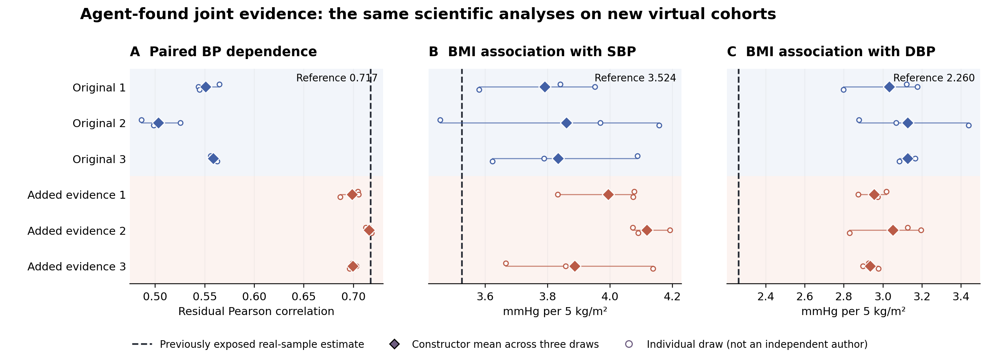

# PNS: Agent-found joint evidence improves one scientific use

Completed 16 November 2026. The frozen experiment delivered all six Agent-authored generators and all 18 planned tables. Additional external joint evidence substantially improved paired blood-pressure dependence in this existing case. Improvements were not uniform across the other analyses.

## What was actually done

1. Selected the existing PNS blood-pressure case because its missing age/sex/BMI-adjusted joint relationship was already explicit and its scientific evaluator was fixed. This is a developmental comparison using a previously exposed reference.
2. A fresh, actual GPT API research Agent searched Europe PMC, inspected original methods/tables and proposed source admission: 14 queries, six full-text downloads, 37 API calls. It found no source identifying the exact target operator, but found two useful partial joint constraints. The root separately checked the relevant original text/tables and source algebra. This manual audit is part of the current implementation; fully automatic source admission is not demonstrated.
3. Froze two arms: the original external evidence packet and the same packet plus the two admitted studies. Three fresh `gpt-6.1-sol` high-effort author contexts per arm independently selected their own scientific laws, parameters and transport assumptions. Shared code, prompts apart from added evidence, task, model and analysis were fixed. This tests the evidence increment, not workflow versus ordinary-Agent superiority.
4. Sealed all six programs before final draws. Used the existing WSL/bubblewrap runtime to generate three predeclared seeds per program, 3,000 people each. No target rows were inputs; this was whole-cohort generation, not single-column imputation. No manual scientific parameter edits, target-feedback calls, retries or generator selection occurred.
5. After all output closed, compared the same three scientific analyses with the existing aggregate PNS reference. Independently recomputed every endpoint from the saved tables using QR rather than the production estimator.

Exact protocol: [PROTOCOL.md](PROTOCOL.md). Inputs, code and dependency hashes: [GENERATION_FREEZE.json](GENERATION_FREEZE.json). All prompts, responses and usage receipts are retained locally under `calls/`; the search episode is under `episodes/PNS_SEARCH/`.

## Scientific results

The regressions use intercept, (age−50)/10, recorded female sex and (BMI−25)/5. Residual correlation uses the same rows and design for both blood pressures. Generated rows have equal weights, representing the declared weighted analytical distribution by assumption; the real reference uses the original laboratory weights. These are association projections, not intervention effects.

| Quantity | Existing real-sample reference | Original evidence: mean | Added joint evidence: mean | Mean absolute reference difference, original → added |
|---|---:|---:|---:|---:|
| SBP–DBP residual Pearson correlation | 0.7172 | 0.5376 | 0.7046 | 0.17962 → **0.01277** |
| BMI–SBP, mmHg per 5 kg/m² | 3.5240 | 3.8280 | 4.0001 | 0.31944 → 0.47613 |
| BMI–DBP, mmHg per 5 kg/m² | 2.2599 | 3.0951 | 2.9795 | 0.83516 → 0.71955 |
| SBP SD, mmHg | 18.1916 | 18.1816 | 18.8729 | 0.32525 → 0.71631 |
| DBP SD, mmHg | 11.0941 | 10.5107 | 11.1757 | 0.58344 → 0.36284 |

Means average seeds within each constructor, then constructors equally. Mean absolute difference is calculated before averaging, so it need not equal the distance of the displayed arm mean. The SD convention is population denominator within the generated table, matching the existing diagnostic. All results, including disadvantages, are retained.

For the question chosen before generation—paired residual dependence—the absolute reference difference decreased descriptively by **92.89%**. Each of the three augmented authors was closer than every original-packet author on this endpoint. Their author-mean correlations were 0.6987, 0.7158 and 0.6993, versus original author means 0.5510, 0.5032 and 0.5585. This is a clear separation in this small experiment, not a general clinical-equivalence or cross-case superiority result.

The two positive BMI associations remained positive throughout. DBP association discrepancy narrowed but remained substantial; SBP association and SBP spread were less close. Therefore the finding is **targeted improvement in an underconstrained joint relationship**, not comprehensive recovery of a population distribution.

Dashed lines denote the existing real-sample estimates; diamonds are constructor means; small circles are the three draws. Connecting ranges are Monte Carlo ranges, not confidence intervals. Blue is original evidence and orange is additional joint evidence. Every constructor and every primary endpoint is shown. [Editable SVG](figures/pns_joint_evidence.svg), [PDF](figures/pns_joint_evidence.pdf).

## What the Agent found and how it used it

- **Burkina Faso, DOI 10.1136/bmjopen-2024-089374, PMC12185928:** a common-sample Pearson matrix and BP SDs support a Schur-complement derivation of residual dependence after age and BMI, approximately 0.788. Sex is not included in that derivation. This is a partial source constraint, not the target residual correlation.
- **Ghana, DOI 10.1371/journal.pgph.0001613, PMC10132648:** joint multilevel models report individual and household residual components. Those operators, covariates and the women-only population differ from the task. They provide information about persistent paired variation, not an interchangeable target coefficient.
- **Uganda** was retained in the search record but withheld from the augmented packet because its text describes the same number as raw and residual correlation and has a different adjustment set. The decision did not use target numerical closeness.

All augmented authors explicitly treated their target covariance choices as **ASSUMED**, informed by these sources. They chose working correlations of 0.70, 0.72 and 0.70; original authors chose 0.55, 0.50 and 0.55. The root did not supply those choices. The augmented authors did not simply relabel the source's raw or multilevel number as the target answer. Nevertheless, the transfer is still not estimated by a validated transport model: this result supports the usefulness of better joint evidence in this case, not exact source-to-target identification.

Two augmented authors used linear conditional means with analytically specified non-Gaussian residual covariance. The third used a nonlinear age component and a conditionally truncated Gaussian model. Original authors used conditioned bivariate Student-t laws with nonlinear age terms. Evidence therefore affected freely chosen modeling decisions, not only one forced parameter. This experiment does not isolate which individual structural change caused each secondary effect.

See [source audit](SOURCE_AUDIT.md), [actual search proposal](episodes/PNS_SEARCH/EVIDENCE_REPORT.json), [source algebra check](inputs/source_derivation_check.json) and [implementation review](IMPLEMENTATION_REVIEW.md).

## Implementation and output quality

- 6/6 valid sealed Agent constructions; 18/18 successful isolated final executions; 54,000 **virtual** rows. These are six stochastic model constructions, not 54,000 patients or 18 independent authors.
- 18 distinct output hashes; no within-table duplicate measurement rows.
- No nonpositive BMI/SBP/DBP and no SBP below DBP among the generated rows.
- All six selected laws have finite relevant population moments: five have bounded delivered BP support; one uses a bounded component plus an affine gamma variable, which also has all positive integer moments. This conclusion comes from code/law inspection, not merely finite samples.
- 108/108 scientific and diagnostic endpoint values independently recomputed, maximum absolute numerical difference **5.23×10⁻¹³**. Ten integration checks passed before freezing. Mathematical source derivation was independently checked by a separate QR construction.
- No source-population replay is claimed from target-population output. Exact numerical source fitting is not demonstrated here. There were no feedback revisions.

## Cost and interpretation

Search: USD0.4059768, 37 calls. Construction: USD0.6500691, six calls. **Total USD1.0560459** at the recorded tariff, with no unknown-usage reservation. Source XML payloads totaled 876,120 bytes; this excludes search/browsing traffic. Compute, root audit time and any broader project costs are not included. These are usage-derived estimates, not a provider invoice.

PNS was already exposed to the project. The new author contexts received no target values, but this does not create a new independent validation cohort. The reference is a weighted complete-case sample estimate, not known population truth. Existing row-bootstrap intervals are recorded in `analysis/REFERENCE_USED.json`; they are conditional IID stability intervals, not national survey-design confidence intervals or clinical equivalence bands. Only three constructions per arm and one case were run.

## Decision

Keep this as positive, bounded evidence for the mainline: **an Agent can identify a missing joint-evidence need, find qualified external information, author a new whole-cohort generator, and obtain a substantially more useful joint analysis in an existing biomedical case.** Keep the slope/scale disadvantages beside it. Do not retune these completed laws to PNS.

Together with the preceding artificial composition pilot, this separates algebraic capability from an observed biomedical use benefit. It does not yet establish a universally better Agent workflow or reliable transport to new cohorts. Close this unit, preserve all artifacts and use the result to sharpen the paper's scientific-use story; no automatic expansion, new model grid, new patient data or renewed automation.
