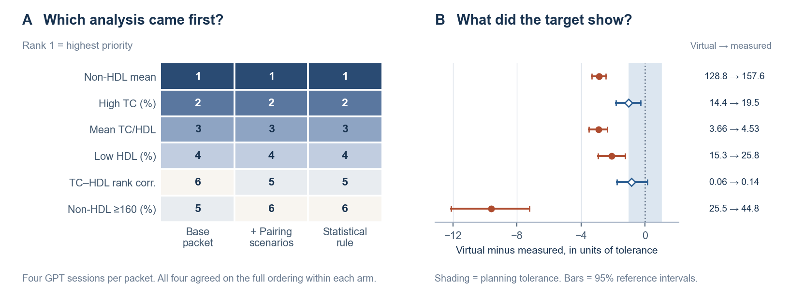
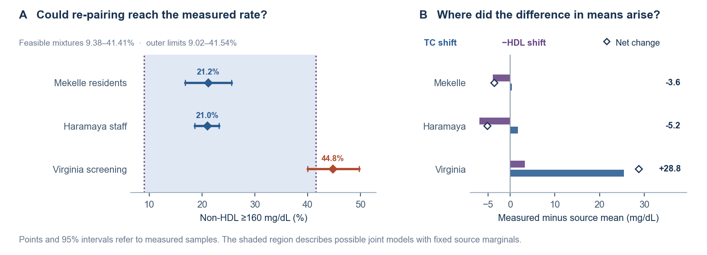

# Which analyses should a researcher trust before seeing the measured sample?

Giving advisers examples of other joint models that fit the published evidence changed which analysis they ranked last. All four advisers who saw the examples put the non-HDL screening percentage last. All four who saw the base packet put the cholesterol rank correlation last. The screening percentage subsequently had the largest discrepancy, 9.61 times its planning tolerance. The two groups and the statistical rule nevertheless gave the same top two recommendations. Neither use achieved confirmed agreement at its stated tolerance. These are decisions about one fixed virtual table in one independently recruited target sample. [Frozen protocol](PROTOCOL.md) · [Rankings sealed before disclosure](https://github.com/ziwang11112/evidence-guided-virtual-cohorts-2026/blob/629068e20e7ed4aadfa2bc68e76a706a8aaf1004/biomedical_research/virtual_cohort_system/work/prospective_lipid_use_2026-11-21/DECISION_CLOSURE.json) · [Opening receipt](REFERENCE_OPEN.json)

## Who and what was compared

The virtual table pools the three frozen draws from the original agent-authored model of total cholesterol (TC) and high-density lipoprotein cholesterol (HDL). Eight fresh sessions using GPT-6.1 Sol received a description of the new target, the same source information, all six estimates from the virtual table and observations from two previously disclosed Ethiopian samples. Four randomly assigned sessions also saw the range from eight agent-authored scenarios and two numerical examples, all compatible with the source constraints. A statistical rule used the same full information to rank uses by the largest source uncertainty, historical discrepancy or scenario shift in units of the respective planning tolerance. Every method ranked six uses and could independently endorse any number, including zero. No new generator was fit. The estimate of the eight model-call charges was US$0.0626196. The closure includes model identifiers, reasons, usage and output digests for all eight. [Base and full packets](PACKET.json) · [Statistical decision](STATISTICAL_DECISION.json) · [All decisions](DECISION_CLOSURE.json)

The new reference was a rural African American community screening study in central Virginia. Of 403 records, 400 unique adults with paired measurements met the prespecified eligibility criteria. We estimated 95% pointwise intervals by resampling participants within Buckingham and Louisa counties 4,000 times. The counties are parts of a single study. Screening ten candidate datasets yielded one eligible study and no verified type 2 diabetes frame. Historical Ethiopian results were available to the advisers. [Study archive](https://hbiostat.org/data/repo/diabetes) · [Original article](https://pubmed.ncbi.nlm.nih.gov/9258308/) · [Admission and exposure](ADMISSION.md)

## The six scientific analyses

The comparison uses each endpoint's original units. We classify agreement when the complete 95% interval for the virtual-minus-measured difference falls within the prespecified planning margin, contradiction when it lies outside, and unresolved when the interval crosses a boundary. Each interval conditions on the fixed virtual table. The margins represent decisions about research use, and their sensitivity was registered before opening the study.

| Requested analysis | Virtual | Measured (95% interval) | Planning margin | Result |
|---|---:|---:|---:|---|
| Mean non-HDL, mg/dL | 128.77 | 157.57 (153.15–162.01) | ±10 | Contradicted |
| Mean individual TC/HDL ratio | 3.659 | 4.530 (4.364–4.714) | ±0.30 | Contradicted |
| Percentage with TC ≥6.2 mmol/L | 14.40% | 19.50% (15.75–23.50) | ±5 pp | Unresolved |
| Percentage with HDL <1.0 mmol/L | 15.30% | 25.75% (21.50–30.00) | ±5 pp | Contradicted |
| Percentage with non-HDL ≥160 mg/dL | 25.53% | 44.75% (39.99–49.75) | ±2 pp | Contradicted |
| TC–HDL Spearman correlation | 0.059 | 0.144 (0.044–0.235) | ±0.10 | Unresolved |

**Primary comparison.** All eight sessions and the rule put mean non-HDL first and high TC prevalence second. The first was contradicted and the second remained unresolved. Seven sessions explicitly endorsed the mean, and one base-packet session endorsed nothing. The rule endorsed only the mean. All eight declined to endorse the non-HDL screening fraction, including those who ranked it fifth. Doubling the margins brought high TC prevalence and rank correlation entirely within tolerance. Low HDL prevalence remained unresolved and the other three comparisons still contradicted their margins. Results for both counties, all three tolerance scales and every coverage from one to six are public. [Machine-readable estimates and scores](RESULTS.json)

**Secondary comparison.** The first four ranks were identical across arms. At a coverage of five uses, scenario-informed advisers and the rule set aside the screening rate. This left three contradicted and two unresolved analyses. Base-packet advisers set aside the correlation, leaving four contradicted and one unresolved. The average absolute discrepancy among the retained analyses fell from 3.70 to 1.95 tolerances. Both county subsets exhibited the same ordering of these two discrepancies. All coverages were prespecified. We singled out the five-use comparison after inspecting the full curve. One study and four sessions per arm provide descriptive evidence of prioritizing a particularly fragile scientific use. The numerical rule identified it too.

## Which discrepancies could a different pairing fix?

This additional diagnostic was specified after the Virginia discrepancy was revealed. Across every possible pairing of the same 16,000 source TC and HDL values, 9.02–41.54% can reach 160 mg/dL. Two explicit numerical constructions give 9.375% and 41.406% while also meeting the mean-ratio and component-order conditions. Random mixtures of the two joint laws attain all intermediate population-level probabilities under those same constraints. The interval is a range of possible models. It carries no probability of transfer to a patient population. [Diagnostic plan and definitions](PAIRING_AUDIT_PLAN.md) · [Complete numerical results](PAIRING_AUDIT.json)

| Measured sample | Participants | Measured screening rate (95% interval) | Agent scenario pairs bracketing the point | Change in mean non-HDL explained by component shifts, mg/dL |
|---|---:|---:|---:|---|
| Mekelle residents | 321 | 21.18% (16.82–25.55) | 4 of 4 | +0.31 TC −3.96 HDL contribution = −3.65 |
| Haramaya employees | 1,164 | 20.96% (18.64–23.20) | 4 of 4 | +1.71 TC −6.90 HDL contribution = −5.19 |
| Central Virginia screening | 400 | 44.75% (39.99–49.75) | 0 of 4 | +25.52 TC +3.28 HDL contribution = +28.79, before rounding |

In Virginia, 179 of 400 participants crossed the threshold. That sample rate exceeds even the unrestricted bound by 3.21 percentage points, exceeding the ±2-point planning margin. Its sampling interval overlaps the bound. The calculation rules out attaining this **observed point** within tolerance by rearranging those particular source values. It leaves open the corresponding rate in the population. A different pairing cannot change the mean of TC minus HDL at all. The 28.79 mg/dL mean discrepancy identifies which measurements would help a researcher next, especially independent evidence on the target TC distribution. In both Ethiopian samples all four agent pairs bracketed the observed point, but bracketing alone gives no rule for picking the most accurate pairing.

## Verification and interpretation

The original CSV and native S serialization agreed on ID, county, age, both assays and the separately recorded ratio. The native-file implementation independently reproduced all six estimators, three tolerance scales, three reference groups, rank inference with ties and the costs. The pairing diagnostic independently checked the empirical outer bounds by counting possible matches across cuts and used tied small examples for verification. Public-only scoring is available via `python -B work/prospective_lipid_use_2026-11-21/verify.py --public-only`. Run without the flag to recompute the new reference locally from the public data archive. The figure script uses only aggregate results. [Verification receipt](VERIFICATION.json) · [Independent scoring](verify.py) · [Pairing calculations](pairing_audit.py) · [Figure code](figures.py)

The study evaluates one unidentified-to-the-model cohort description, one GPT configuration and one previously sealed virtual table. Voluntary screening, treatment mix, measurement conditions and differences from the Tanzanian source can affect transfer. Some historical public datasets may have entered model training. Intervals reflect variation among measured participants conditional on county sizes and the virtual outputs. The observed ranking supports using alternative models to investigate a fragile analysis. A decision to rely on an estimate in a new population still requires evidence about that population.
