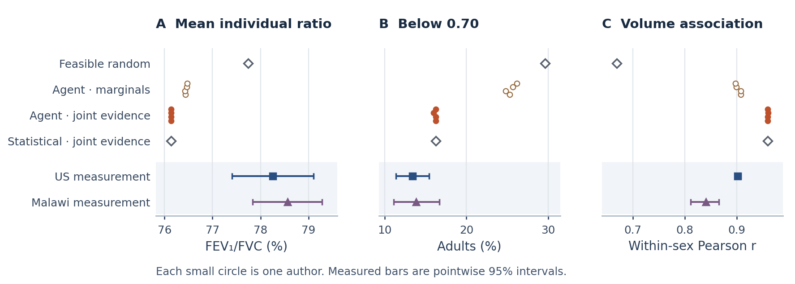

# Can a source-based virtual cohort reproduce pre-bronchodilator spirometry analyses?

Eight GPT constructors read Polish spirometry evidence and wrote programs that paired FEV1 with FVC for the same virtual person. They received no measured pairs or findings from the target samples. Four saw the separate volume summaries. Four also saw the published within-sex correlation and regressions. Their whole-cohort predictions, code and statistical comparators were made public before opening either reference. The two measured samples comprise **3,945 US adults and 586 adults returning for follow-up in rural Malawi**. [Protocol registration](https://github.com/ziwang11112/evidence-guided-virtual-cohorts-2026/commit/1eab039a267097414b6dc8563ee4b7c87a19971e) · [Prediction registration](https://github.com/ziwang11112/evidence-guided-virtual-cohorts-2026/commit/7a603a73749ee068c4ddc1b5915bb238187acfdb)

| Group-level use | Agent with marginal evidence | Agent with additional joint evidence | Statistical rule with the same joint evidence | Measured US [95% interval] | Measured Malawi [95% interval] |
|---|---:|---:|---:|---:|---:|
| Mean of individual FEV1/FVC ratios (%) | 76.45 | 76.14 | 76.14 | 78.26 [77.41, 79.10] | 78.56 [77.84, 79.28] |
| Ratio of the two group means (%) | 76.32 | 76.32 | 76.32 | 78.34 [77.53, 79.15] | 78.44 [77.70, 79.15] |
| Individual ratio below 0.70 (%) | 25.50 | 16.26 | 16.26 | 13.37 [11.34, 15.40] | 13.81 [11.12, 16.68] |
| Within-sex Pearson correlation | .904 | .960 | .960 | .902 [.897, .908] | .841 [.811, .866] |

Each agent entry is the median of four authors' predictions, each averaged over three seeds. The studies are standardized to equal sex weights. These are research-study estimates. The Polish source recruited healthy never-smokers aged 18–85. The US and Malawian samples include a broader community population aged 18–79. US intervals incorporate the survey design. Malawi's intervals resample returning participants within sex. The public file lacks village identifiers and design weights. [Full scientific and interval results](RESULTS.json) · [Source conditions and target eligibility](ADMISSION.md)

## What the agent contributed

All four marginal-only authors chose a latent working correlation of 0.90, with different algorithms for respecting FEV1 ≤ FVC. Supplying the original paper's Pearson correlation of 0.96 and simple regressions moved all four authors to a source-calibrated Gaussian rank law. They wrote and executed their own pairing programs. The common interface fixed the component distributions and allowed any permutation preserving those columns. Every completed virtual table satisfied the volume inequality. A separate uniform draw among physically possible pairings predicted 29.61% below 0.70 and a mean individual ratio of 77.74%. [Programs and declared assumptions](laws/) · [Per-author predictions, raw feasibility and repairs](PREDICTIONS.json)

The source's joint statistics mattered for the **fraction below 0.70**. Relative to marginal-only authors, its median absolute discrepancy fell by **9.24 percentage points at each measured point**. This equality follows from the same virtual predictions being above both measured fractions. It does not represent two independently estimated effect sizes. All four joint-evidence authors satisfied the 5-point use margin throughout the US interval. One of four did so in Malawi; the other three crossed the tolerance boundary. All four marginal-only authors exceeded the margin across both complete measured intervals. On the **mean individual ratio**, the same evidence increased median absolute error by 0.32 percentage points at each site. It also increased error in the within-sex association. Each full-evidence author's correlation falls outside its 0.05 use margin throughout both measured intervals. The ratio of means remains fixed when the same columns are re-paired. [Intended use and error contrasts](RESULTS.json)

## The matched statistical comparison

The prespecified primary test required a 1-point improvement in the median author's absolute error on the mean individual ratio at both sites. It was **not met**. Even before seeing either reference, the distance between the frozen predictions bounded the maximum possible median improvement at **0.000101 percentage points** on that endpoint. The analogous bound on the fraction below 0.70 was **0.00407 points**. For these bounded comparisons, four similar models gave essentially the statistical rule's answers. The same models' absolute accuracy differed across scientific uses. The four authors' screening predictions ranged from 15.98% to 16.26%. Individual-author discrepancies can exceed the bound for the median. [Calculation and full pre-disclosure statement](BEFORE_DISCLOSURE.md)

A post-disclosure diagnostic supplied each population's separate marginal distributions and kept the original within-sex pairings. The median full-evidence individual ratios moved to 78.02% in the US and 78.25% in Malawi. The below-cutoff proportions moved to 8.93% and 7.15%. Thus supplying better component levels made the mean ratio closer at both sites, while increasing the screening discrepancy. Some diagnostic US pairs violated the physical order (median 0.008% for the full-evidence authors). This diagnostic quantifies how much the scientific conclusion changes when the margins are supplied by the reference. [Diagnostic estimates for every method](RESULTS.json)

## Audit and study size

- The Malawian deposit describes baseline and follow-up testing. Its baseline file publicly releases post-bronchodilator volumes only. The first follow-up supplies the first available pre-bronchodilator pair and quality flags. Of 628 unique returnees in that sheet, 586 met the age, quality and pair requirements. Three included measured pairs had FEV1 above FVC and were retained as specified. The corresponding US count was zero. [Original Malawi deposit](https://data.mendeley.com/datasets/whbk485wbw/1) · [US quality definitions](https://wwwn.cdc.gov/Nchs/Data/Nhanes/Public/2011/DataFiles/SPX_G.htm)
- Eight completed GPT calls and three draws per author produced 24 agent tables. Two statistical rules contributed six tables. Each has 8,192 virtual rows. Aggregate estimates and code are public. Study microdata, generated records and detailed provider responses remain local. Usage-derived cost was **USD 0.2505612** under the recorded project tariff. [Model, timing, usage and request hashes](AUTHORS.json)
- Independent code recomputed all four estimates and pointwise intervals per country and read all 30 saved virtual tables. A separate exact-decimal implementation of the 0.70 cutoff gave the same results in both cohorts. All 2,000 bootstrap replicates yielded defined estimates. An early local fixture-import problem was corrected before public protocol registration. [Independent verification](VERIFICATION.json) · [Exact-cutoff check](THRESHOLD_QC.json) · [Preflight record](PREFLIGHT_NOTE.md)
- The experiment expands the manuscript to **six domains, 17 scientific-use–sample comparisons, 15 distinct study samples or survey periods, 13 study families and ten countries**. NHANES 2011–12 already supplied grip measurements. Malawi adds a recruited study. Neither the eight sessions nor repeated seeds add independent populations. [Accumulated inventory](COVERAGE.json)

**Paper decision.** Use spirometry as a prospective matched-input comparison beside handgrip. Handgrip shows a scientific use improved by coupling two measurements. Spirometry shows the size of the possible agent–statistical difference can already be bounded from the frozen predictions, and demonstrates a scientific use for which adding joint evidence helps despite worse correlation transport. Retain the primary null and the contrasting downstream uses in the manuscript.
