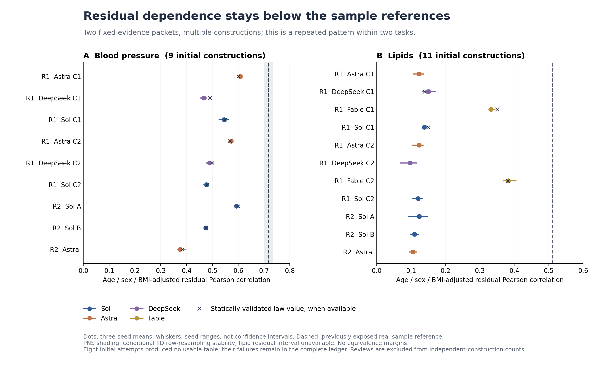
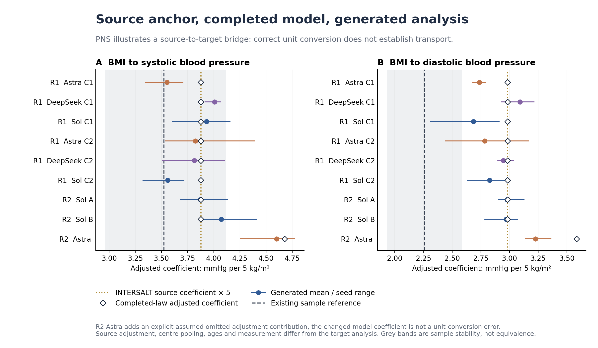

# Two-round synthesis: parameter provenance and scientific analyses

The combined result is not that all Agents copy the same numbers. They consistently turn fixed source packets into executable joint models, but must complete different unreported parts of those models. Most checked mathematical constructions implement their stated assumptions coherently. Agreement with real analyses then varies by the particular estimand and by the source, conditioning and population bridges used.

## Scope and counting

This synthesis uses only the two completed API pilots dated 2026-11-10. Both are **whole-cohort generation with no target individual covariates supplied**: blood pressure in the PNS context and lipids in the Turkana study context. It is not a summary of every earlier biomedical experiment or proof of missing-cell/column recovery. The evidence packets, initial task instructions, reference snapshot and shared statistical engines match across these rounds. Sources and measurements were not newly reauthenticated; this audit checks the existing admitted packets and captured artifacts.

- 32 API requests: 28 initial construction attempts and four dependent reviews of two fixed Sol parents.
- 21 complete initial API artifacts; 20 initial generators delivered analyzable tables. One complete DeepSeek artifact failed at execution.
- Four reviews: three exact code/specification no-ops and one changed age-distribution program. These do not create four new independent authors.
- 96 scheduled evaluation table slots: 72 successful files, three execution failures and 21 unavailable-candidate slots. These contain 63 distinct file hashes. Six additional diagnostic tables were used in round two.
- Seeds describe sampling from a fixed model. Unique files, unique program/specification pairs and mathematically distinct probability laws are different quantities; none is a count of independent clinical studies.
- Total known usage-derived tariff estimate across both pilots: $14.14412666, with $0.21840852 still reserved for unknown usage. No new API calls, generation or real-patient analysis were performed for this synthesis.

## What comes from sources, and what the Agent adds

| Requested analysis | Admitted source information | Additional construction needed | What the combined results show |
|---|---|---|---|
| BMI–SBP/DBP regression | INTERSALT 0.7754 / 0.5967 mmHg per kg/m², with additional sodium/potassium/alcohol adjustment and centre-level pooling | Fivefold unit conversion is algebraic; equality after changing adjustment, age range, measurement and population is assumed | Most laws adopt 3.877 / 2.9835 per five BMI units. R2 Astra instead adds an explicit assumed omitted-adjustment contribution, producing 4.677 / 3.5835 as model-law slopes. Generated estimates follow the completed law with sampling variation, not a guaranteed target effect |
| SBP–DBP residual correlation | No compatible conditional residual correlation. Beijing marginal SBP, DBP and pulse-pressure SDs permit a raw covariance calculation | Conditional covariance requires a mean/covariate model; direct rho values, error-factor structures and covariance subtraction encode additional assumptions | All nine delivered PNS initial constructions have mean residual correlation below the existing sample reference; their internal choices are materially different |
| BMI–TC/HDL adjusted regression | Obirikorang rural unadjusted Spearman anchors 0.212 and −0.100; other sources provide margins or differently defined regressions | Rank-to-latent-copula mapping, raw margin transformations, sex/age conditioning and population transport; these do not directly identify requested raw adjusted slopes | Some laws leave scalar estimands unknown and provide a projection recipe; others choose additive effects. A source rank must never be displayed as the target regression coefficient |
| TC–HDL residual correlation | Rural source TC–HDL Spearman 0.106, plus marginal moments; no matched target adjusted residual Pearson correlation | Residual dependence emerges from the complete joint model. Conditional versus pooled copulas and component decompositions matter | All eleven delivered lipid initial constructions lie below the existing sample reference. Claude C2's zero HDL–non-HDL error correlation induces TC–HDL residual correlation about 0.381; zero is not its requested endpoint |
| Dispersion / age tails | Some sources report marginal means/SDs; these are not conditional residual SDs, coefficient SEs, or transport uncertainty | Variance subtraction, distributional shape, target composition, and support limits | Dispersion is not universally too small. R2 Sol_B SBP SD exceeds its sample reference. Feedback repaired one extreme age tail using an explicitly assumed cap of 100, not newly acquired evidence |

Each parameter is therefore labelled with **multiple provenance components when appropriate**: reported anchor, algebra under a model, and unverified assumptions. These are not mutually exclusive classes or calibrated confidence scores. A numerically derived value can still depend strongly on an assumed population or conditioning bridge.

## The reproducible pattern and its limits

Across the 20 data-delivering initial constructions, all mean residual correlations fall below their case's existing sample reference:

- PNS: nine initial constructions, approximately **0.375–0.608**, versus **0.717** in the sample reference.
- Lipids: eleven initial constructions, approximately **0.097–0.382**, versus **0.512**.

This supports a repeated descriptive pattern within two fixed tasks and shared evidence packets. It is not twenty independent datasets, a universal LLM bias, or proof that all gaps are caused by conditional independence. Structural alternatives, source transfer, demographic assumptions and reference uncertainty remain possible contributors. Gemini produced no usable initial artifact and cannot be assigned a scientific dependence result.

## Separate the declared model from its generated sample

For statically validated final-law functionals, the ledger explicitly separates:

`generated estimate − sample reference = (generated estimate − completed-law value) + (completed-law value − sample reference)`.

This is an arithmetic decomposition, not causal attribution. The first term includes finite-sample fluctuation; the second combines scientific scenario choices, transport and sample-reference differences. A model coefficient is not automatically the requested estimand after selection, truncation, nonlinear transformation or omitted conditioning. Unknown model-law values are left missing, not inferred backwards from generated or target results.

PNS provides the cleanest examples. Its additive laws often imply the source-scaled slopes exactly, yet target applicability is unverified. R1 Astra C2 illustrates why innovation and regression-residual correlations differ when a nonlinear age component remains in linear residuals. R2 Astra illustrates an explicitly assumed adjustment bridge changing the requested coefficient.

## All delivered initial analysis results

Each number is a mean across the three prespecified seeds of one construction, not an independent-study estimate or confidence interval. PNS outcomes are SBP then DBP, with slopes in mmHg per 5 kg/m². Lipid outcomes are TC then HDL, with slopes in mg/dL per 5 kg/m². Complete seed ranges, reference uncertainty and failures are in the machine-readable ledger.

### Blood pressure

| Construction | Model | BMI–first outcome | BMI–second outcome | Residual correlation |
|---|---|---:|---:|---:|
| R1 / PNS_OA_ASTRA_C1 | GPT Astra | 3.553 | 2.736 | 0.608 |
| R1 / PNS_DS_PRO_C1 | DeepSeek | 4.008 | 3.092 | 0.467 |
| R1 / PNS_OA_SOL_C1 | GPT Sol | 3.931 | 2.684 | 0.545 |
| R1 / PNS_OA_ASTRA_C2 | GPT Astra | 3.824 | 2.782 | 0.572 |
| R1 / PNS_DS_PRO_C2 | DeepSeek | 3.815 | 2.947 | 0.488 |
| R1 / PNS_OA_SOL_C2 | GPT Sol | 3.560 | 2.826 | 0.477 |
| R2 / PNS_SOL_A | GPT Sol | 3.871 | 2.979 | 0.593 |
| R2 / PNS_SOL_B | GPT Sol | 4.070 | 2.970 | 0.474 |
| R2 / PNS_ASTRA | GPT Astra | 4.600 | 3.226 | 0.375 |
| Existing sample reference | — | 3.524 | 2.260 | 0.717 |

### Lipids

| Construction | Model | BMI–first outcome | BMI–second outcome | Residual correlation |
|---|---|---:|---:|---:|
| R1 / LIPID_OA_ASTRA_C1 | GPT Astra | 10.774 | -1.668 | 0.123 |
| R1 / LIPID_DS_PRO_C1 | DeepSeek | 7.835 | -1.202 | 0.151 |
| R1 / LIPID_CL_FABLE_C1 | Claude Fable | 9.369 | -1.257 | 0.333 |
| R1 / LIPID_OA_SOL_C1 | GPT Sol | 8.452 | -1.693 | 0.139 |
| R1 / LIPID_OA_ASTRA_C2 | GPT Astra | 9.631 | -1.909 | 0.123 |
| R1 / LIPID_DS_PRO_C2 | DeepSeek | 7.867 | -1.599 | 0.097 |
| R1 / LIPID_CL_FABLE_C2 | Claude Fable | 9.341 | -1.207 | 0.382 |
| R1 / LIPID_OA_SOL_C2 | GPT Sol | 8.687 | -1.975 | 0.121 |
| R2 / LIPID_SOL_A | GPT Sol | 10.456 | -2.063 | 0.124 |
| R2 / LIPID_SOL_B | GPT Sol | 9.594 | -2.189 | 0.110 |
| R2 / LIPID_ASTRA | GPT Astra | 9.138 | -2.219 | 0.105 |
| Existing sample reference | — | 5.683 | -4.623 | 0.512 |

## Failures and corrections retained

| Attempt | API / execution result |
|---|---|
| R1 / PNS_CL_FABLE_C1 | incomplete_response; not_delivered |
| R1 / LIPID_GE_CARBON_C1 | incomplete_response; not_delivered |
| R1 / PNS_GE_CARBON_C1 | incomplete_response; not_delivered |
| R1 / PNS_CL_FABLE_C2 | incomplete_response; not_delivered |
| R1 / PNS_GE_CARBON_C2 | incomplete_response; not_delivered |
| R1 / LIPID_GE_CARBON_C2 | incomplete_response; not_delivered |
| R2 / LIPID_DS | transport_or_capture_error; not_delivered |
| R2 / PNS_DS | received; execution_failed |

Three distinct issues must remain separate:

1. **Implementation failure:** R2 PNS_DS indexes a DataFrame with column descriptor dictionaries and raises `TypeError: unhashable type: 'dict'`. Its abstract law can be coherent while no table is delivered.
2. **Unsupported mathematical claim:** R1 LIPID_DS_PRO_C2 positivity-rejects proposal errors. Its pre-rejection coefficients and covariance do not establish the claimed exact final-law slopes or residual correlation. The observed numerical discrepancy alone does not determine how much the rejection changes the estimands.
3. **Unverified scientific bridge:** most other audited core formulas are internally coherent, but marginal/rank evidence does not uniquely identify target conditional relationships. Internal arithmetic correctness does not settle transportability.

**Audit erratum:** the earlier review incorrectly criticized R1 LIPID_OA_ASTRA_C1 for using Greiner `.rows` paths. The frozen packet actually uses `format`, `columns`, and `rows`, not `records`. All sixteen pointer occurrences resolve, and all twelve named statistic IDs match. That criticism is withdrawn in the alignment audit. Original frozen files and numerical results remain unchanged; the correction must not be counted as an Agent error.

## What the review branches add

Only the R2 lipid feedback branch changed its data-generating program. Its age support changed to a beta distribution on [18,100]. At matched evaluation seeds, all non-age fields remained exactly identical. Maximum ages changed from about 198, 226 and 300 to 96, 98 and 99; HDL > TC remained 34/9,000 rows and scientific lipid estimates barely changed. The age cap is an explicit additional assumption. This is a local secondary repair, not improvement on the prespecified component-consistency endpoint or new evidence for joint relationships. Three no-op branches preserve their parents and remain visible in the full ledger. There are only two paired parents. Concurrent requests dispatched feedback before ordinary review in both cases, so the intended branch-order counterbalancing was not achieved; this deviation does not change the frozen prompts or parent assignments.

## How to read scientific usefulness

A source-aligned relation, a coherent model law, a successful implementation, and agreement with a target sample answer different questions. This synthesis does not merge them into a single pass score. PNS reference intervals describe conditional IID row-resampling stability, not national design-based confidence. Lipid coefficient intervals use conditional HC3 sensitivity assumptions; the TC interval is broad and includes zero. The lipid residual interval is unavailable. Seed ranges are not confidence or transport-uncertainty intervals, and no post-hoc equivalence margin is used.

The most defensible next focus is **analysis-specific evidence sufficiency and the Agent's completion of unreported joint structure**. The records now show where a useful relation is anchored, where algebra is valid only under a completed model, and where a free assumption materially changes the analysis. The current provenance labels describe these dependencies; their ability to predict new-target error has not been prospectively validated. No additional experimental arm or model call is started by this synthesis.

## Files

- [Interactive index](index.html): choose a construction, inspect all analyses, and read its core parameter provenance.
- [Attempt ledger](ATTEMPTS.csv): all 32 calls, status, lineage and costs.
- [Analysis results](ANALYSIS_RESULTS.csv): all 192 endpoint summaries, including diagnostics and failures.
- [Parameter sources](PARAMETER_SOURCES.csv): source anchors, transformations, assumptions, operators and code/specification locators.
- [Seed results](SEED_RESULTS.csv): all 576 scheduled endpoint-by-seed rows.
- [Validated-law decomposition](LAW_REFERENCE_DECOMPOSITION.csv): only rows with a statically supported numerical law functional.
- [PNS parameter audit](PNS_PARAMETER_MAP.md), [lipid parameter audit](LIPID_PARAMETER_MAP.md), [round alignment and erratum](ROUND_ALIGNMENT_AUDIT.md).
- [Complete structured synthesis](SYNTHESIS.json).

All material is an audit of previously completed experiments. Raw patient data, raw API transcripts and synthetic row-level tables are not copied into this synthesis package.
