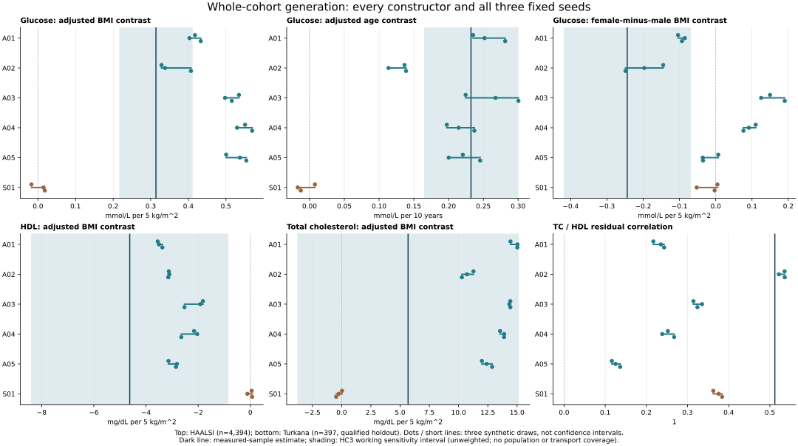

# Wave A: complete evidence-only cohort generation and scientific-use evaluation

Completed 2 November 2026. **The system generated and evaluated complete virtual cohorts, with useful directional results but insufficient reliable recovery of all prespecified analyses. The positive Wave A criterion failed. No Wave B expansion is started.**

This is a completed experiment, not a proposal or a software-only checkpoint. The constructors received published evidence and population/measurement descriptions, with **zero participant records supplied**. The study remains about virtual biomedical data for scientific analysis. One scientific Agent authors each construction; five independent constructions per case assess construction variability, not multi-Agent collaboration.

## What was actually done

| Quantity | Actual count and interpretation |
| --- | --- |
| Real target cases | 2: HAALSI glucose and Turkana lipids |
| Eligible measured reference records | 4,394 HAALSI; 397 Turkana; fixed eligibility, unweighted |
| Scientific Agent constructions | 10: five fresh contexts per case |
| Prescribed statistical constructions | 2: one S01 per case |
| New generated tables | 84: 48 source-context and 36 target-context tables |
| Rows per table | 5,000; 420,000 virtual rows in total, not additional patients |
| Target seeds | 2101, 2102, 2103, fixed for every construction |
| Source-feedback decisions | All ten Agents retained; both prescribed references also retained |
| Changed final generators | 0; final outputs alias initial outputs, with no extra draw |
| Evaluated target reporting slots | 72 initial/final slots; 36 unique tables and 36 retained aliases |
| Fixed scientific analyses | 3 per case; 108 unique generated-table endpoint estimates, represented in 216 initial/final reporting cells |
| Clinical execution/whole-frame guards | All 84 scheduled new tables succeeded; no generation retry or row repair |
| Independent verification | 6,704 comparisons, zero failures; largest generated-estimate absolute difference 3.73e-14 |

K01 is the prospectively admitted HAALSI case. K02 remains an **investigator-context-exposed prospective quantitative holdout**, because earlier Turkana article reading disclosed adjacent results. It is not promoted to fully unseen confirmation. Constructors had new contexts and did not receive measured target statistics or tables; this procedural separation does not prove absence of pretraining exposure.

## Implementation and information flow

1. The approved task packet contains source statistics, their population/measurement context, units, uncertainty semantics and explicitly unavailable operators. K01 uses MIND-China and Ayele source views; K02 uses six sex/site contexts from the reviewed Greiner evidence.
2. Each Agent authors `generator.py`, the complete scientific specification, context descriptors, assumptions/provenance and its decision/check records. The Agent chooses marginal laws, dependence structure, target composition and transport assumptions. The coordinator packages the artifacts and does not insert required target slopes, signs, means or SDs.
3. An independent reviewer checks actual code, provenance and interface commitments. Freeze and context-bridge review bind identical code and the complete common model across contexts, changing only the active context selector. The runtime samples the Agent-authored program in the isolated guarded runner. **This is Agent-designed program generation, not direct language-model emission of every row.**
4. Source-only feedback returns authenticated execution and explicitly approximate descriptive comparisons. It never returns target-table results. The same Agent chooses retain, revise or stop. All ten chose retain; the controller did not force a revision to create an apparent improvement.
5. All twelve constructor inventories closed before the single target-reveal event. The designated, previously released evaluator then read both measured references and analyzed every reserved target slot with the frozen eligibility, unit conversion and formulas. No construction was selected after seeing target results.
6. A fresh independent verifier implemented the mathematics from the frozen specifications, committed its results before opening production results, and then compared the full outputs. Reference eligibility, effects, SDs, HC3 working intervals, discrepancies, aliases, resolution grid and stopping decisions agree. See [independent verification](independent_recompute/INDEPENDENT_RECOMPUTATION_NOTES.md).

Strict source replay remains unavailable where original weights or estimator conventions are unresolved. K01's 18 and each Agent K02 construction's 24 descriptive comparisons are separately labelled approximations; S01 K02 declares no proxies. Small discrepancies in these source margins do not certify missing joint relationships or transport. Confidence intervals from a source publication were not used as individual SDs or acceptance bands.

## The actual scientific results

Dark vertical lines are measured-sample estimates. Shading gives reference-only HC3 normal working sensitivity intervals, not design-based population or transport coverage. Synthetic dots and short horizontal lines show the three fixed draws, not confidence intervals. All constructions and all endpoints are displayed. Final and initial values coincide by retention.

| Case | Prespecified analysis | Measured-sample estimate | Agent result across all five constructions and three seeds |
| --- | --- | ---: | --- |
| HAALSI | Glucose contrast per 5 kg/m² of BMI, adjusting age and sex | 0.3138 mmol/L | All 15 positive; generated range 0.3285–0.5698 |
| HAALSI | Age contrast per 10 years, adjusting BMI and sex | 0.2322 mmol/L | All 15 positive; range 0.1136–0.3005 |
| HAALSI | Female-minus-male BMI contrast, common age adjustment | -0.2440 mmol/L per 5 kg/m² | Direction agrees in 8/15 draws; A03/A04 reverse it on all seeds |
| Turkana | HDL–BMI contrast per 5 kg/m², adjusting age and recorded sex | -4.6230 mg/dL | All 15 negative; range -3.5509 to -1.8173 |
| Turkana | TC–BMI contrast per 5 kg/m², same adjustment | 5.6831 mg/dL | All 15 positive; range 10.2822–15.0413 |
| Turkana | TC/HDL residual correlation after age, sex and BMI | 0.5121 | All 15 positive, but range 0.1162–0.5361 |

All slopes are descriptive projections, not causal effects. The Turkana TC slope's working interval spans zero (-3.7535 to 15.1197 mg/dL); agreement with its positive point direction does not establish a positive population effect. These counts are repeated-construction/seed descriptions, not independent clinical replications.

The directional results preserve genuine scope for **selected analytical feasibility**. They do not establish that every analysis of these generated cohorts is reliable. A02 happens to approximate the lipid residual correlation well, whereas other constructions do not; selecting A02 retrospectively would change this experiment into development, not improve the frozen result.

## Frozen decision rule and sensitivity

For slopes, discrepancy is `abs(generated contrast - measured-sample contrast) / measured outcome sample SD`; for residual correlation it is absolute correlation difference. The prespecified working resolution is 0.10. This is an author-selected research resolution, **not 10% error or biomedical equivalence**. A construction passes only if all three analyses on all three seeds satisfy it. Case reliability requires at least four of all five Agent constructions. S01 is reported separately.

| Resolution | HAALSI Agents passing / 5 | HAALSI S01 | Turkana Agents passing / 5 | Turkana S01 |
| ---: | ---: | :---: | ---: | :---: |
| 0.05 | 1 | No | 0 | No |
| **0.10 (fixed primary)** | **3** | **No** | **0** | **No** |
| 0.20 | 5 | Yes | 1 | No |
| 0.30 | 5 | Yes | 4 | Yes |

The complete per-construction maxima are in [the result table](CONSTRUCTOR_RESULTS_TABLE.md); raw estimates, directions, discrepancies and all four resolutions are retained in `evaluation/PUBLISHABLE_AGGREGATES.json`. No threshold is substituted after disclosure.

HAALSI has a further important failure of discrimination. Its glucose SD is 3.1696 mmol/L. Setting each of the three relationships to zero yields discrepancies 0.0990, 0.0733 and 0.0770, all within 0.10. Thus even apparent passing constructions at that resolution cannot, by that criterion alone, demonstrate recovery of nonzero joint signal. S01's HAALSI maximum is just above the boundary (0.1045); contrasting its failure with Agent passes would overstate the evidence for superiority. The zero-anchor check was specified before disclosure and correctly prevents a positive expansion decision.

At the primary resolution, both cases also miss the four-of-five reliability requirement. **Positive Wave A = false.** K02 alone could not have enabled expansion in any event. The larger tolerances are sensitivity results, not a rescue of the primary decision.

## What this establishes, and what it does not

Supported: a functioning, audited route from external study evidence to whole virtual cohorts without individual inputs; reproducible source-context and target-context execution; preservation of several coarse association directions in these measured samples; and explicit demonstration that some joint analyses vary substantially across constructions with similar approximate source margins.

Not established: general replacement of patient collection; accurate individual measurements; recovery of all joint relations; calibrated source/transport uncertainty; clinical or population equivalence; superiority to capable alternative generators; a benefit from revision; or top-venue readiness. All ten Agents retained, so this wave contains **zero changed-final evidence** and zero observed revision gain. Retention is a valid outcome, not an execution failure.

Interpretation: source marginal agreement coexists here with uncertain joint-analysis recovery. This is consistent with missing joint constraints and transport assumptions being important, but the experiment does not isolate them as the causal reason for failure. More source marginal fitting, more rows or more seeds would not itself supply those missing constraints. Between-constructor spread is visible, but has not been validated as calibrated uncertainty or an error detector.

## Decision and next useful work

Close both targets permanently to confirmation and parameter tuning. **Stop expansion of this exact design into Wave B.** Preserve all results, including the primary failure, the nondiscriminating resolution and retained decisions. No new case, search, target download, training, paid API or HPC job is initiated by this report.

The broad virtual-data objective remains. The next design question should be narrow and tied to it: before generating a cohort, can the system identify which requested analyses have relevant joint evidence, which require transport assumptions, and which should be delivered only as explicitly labelled scenarios? A future discriminating experiment would need verified joint/conditional evidence and an independently fixed analysis-use tolerance; it must not tune either to the now-revealed HAALSI or Turkana answers. This is a proposed refinement, not a newly demonstrated contribution or permission to launch another batch.

Drafting can now use the actual executable method, complete experiment and limitations. A claim that the current system reliably supports arbitrary downstream scientific analyses remains blocked. The current evidence supports a bounded feasibility-and-failure analysis; it does not yet support a broad validated generator claim.

## Audit trail, retained failures and cost

The global release is `9d7576d1e5bda2c88f7a58ad590d962184f9236aea66185b40d11942e700e8f7`; closed inventory `7ee02537d94b4633dd6576afa82215da29acd81e11164a98bb4f028b71fd95c5`; single reveal `880c642fade4ac1b732e14c1ae830756f0937d923eb807e315df541113218e9a`. The designated evaluator hash and exact results are preserved in the evaluation receipts. Historical pure-function fields saying `prospective_not_released` are unchanged labels; actual authorization is the global-release/closure/reveal chain, not those labels. Their `file_access_performed=false` describes the pure function; the separate evaluator did read the authorized files.

Before clinical execution, five invented software-smoke attempts failed because the isolated runtime lacked SciPy; these are retained and were not retried as clinical constructions. A separately versioned pure special-function runtime check passed after the pinned installation. Forty distinct new submission/evaluation tests passed. One initial K01/A01 static descriptor-shape rejection was corrected by its Agent without changing the scientific law; original drafts remain retained. No clinical generation failed or was retried.

The runtime used local CPU and existing subagent access. No new paid API, training or HPC was used. The cumulative metered acquisition ledger remains 289,464,025 bytes, including the pinned SciPy wheel; browser/index traffic and model-token cost were not comprehensively metered and are not claimed to be zero. Real and generated participant-level tables, full third-party documents and credentials stay local. Public export contains reviewed original code, metadata, aggregate results and this figure.

The protocol and first 56 generated-table execution records were published **before reveal** in [commit 017da09](https://github.com/ziwang11112/evidence-guided-virtual-cohorts-2026/commit/017da09e7982a2359dfb247d2b91ebc4a99d5527). That partial checkpoint was not the final inventory. All 84 tables and twelve closures are accounted for here.
